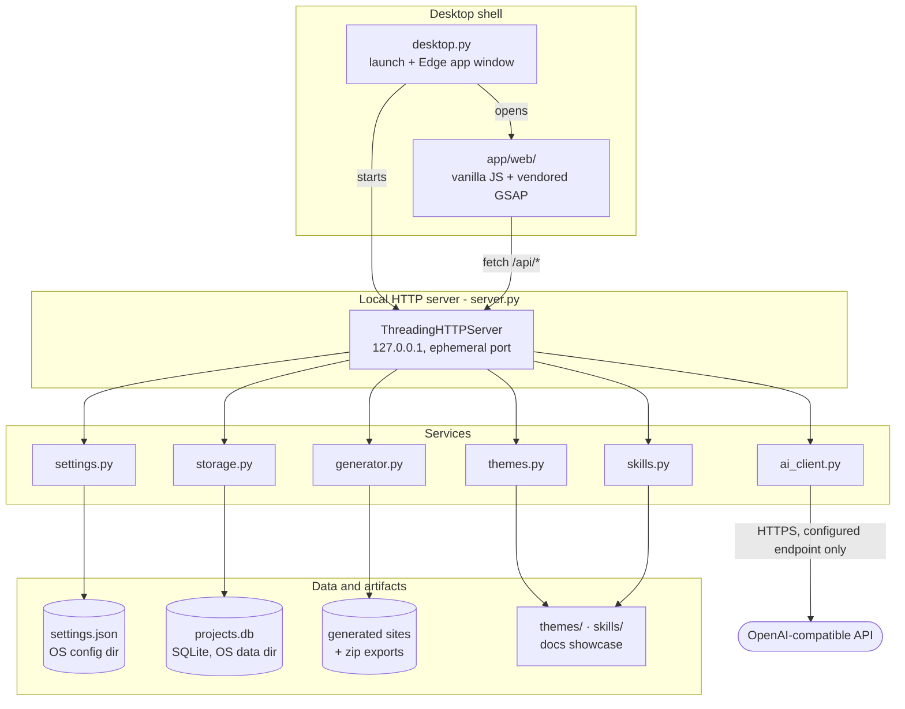

# Stitchcraft Desktop Studio - Design

This document turns `requirements.md` into an implementation design for v0.2,
the desktop studio. The studio is a thin local shell around the same stitch
vocabulary v0.1 defined: a prompt plus a theme package plus selected skills is
assembled into a generation pipeline whose stages are named after the
nine-module stitch, and the output is a static site the user can preview,
persist and export. Nothing here replaces the v0.1 CLI or its guarantees; the
new code is additive and lives beside the validator, not inside it.

## Architecture

Four layers, from the window to the artifacts:

- **Desktop shell (`src/stitchcraft/desktop.py`, `app/web/`)** — starts the
  server, opens an Edge app window (browser-tab fallback) and hosts the
  single-page UI. The UI is vanilla JavaScript plus a repository-vendored GSAP;
  it talks to the server over `fetch` and never imports Python.
- **Local HTTP server (`src/stitchcraft/server.py`)** — a stdlib
  `ThreadingHTTPServer` bound to `127.0.0.1` on an ephemeral port, dispatching
  `/api/*` JSON/SSE routes and serving the UI plus safe preview files.
- **Services (`settings.py`, `ai_client.py`, `storage.py`, `themes.py`,
  `skills.py`, `generator.py`)** — the behaviour: secret-aware settings, the
  OpenAI-compatible client, the SQLite project store, the two catalogue
  loaders, and the generation engine with mock and AI modes.
- **Data and artifacts** — the settings file in the OS config directory, the
  SQLite database in the OS data directory, generated sites and zips in the
  output directory, and the repository's own `themes/`, `skills/` and
  `docs/` data.



Dependencies point one way: `app/web/` knows only the HTTP contract, the server
knows the services, and the services know data. The desktop shell starts the
server but does not import its request handlers; the generator never opens a
socket to the UI. The core v0.1 modules (`loader.py`, `validate.py`,
`render.py`, `model.py`) stay independent of every v0.2 file, which is why
`stitch validate` remains offline and model-free (R13, v0.1 R9).

### Paths and environment overrides

All mutable state lives outside the repo. The service layer resolves each root
through one helper with an environment override, so tests get hermetic temp
directories and the user's real configuration is never touched (R13):

| Root | Default | Override | Holds |
| --- | --- | --- | --- |
| Config | OS config dir: `%APPDATA%\stitchcraft` (Windows), `$XDG_CONFIG_HOME/stitchcraft` or `~/.config/stitchcraft` | `STITCHCRAFT_CONFIG_DIR` | `settings.json` |
| Data | OS data dir: `%LOCALAPPDATA%\stitchcraft` / `~/.local/share/stitchcraft` | `STITCHCRAFT_DATA_DIR` | `projects.db`, generated sites |
| Output | Same as data root, `projects/<id>/` | `STITCHCRAFT_OUTPUT_DIR` | generated site files, zips |

The repository is never a state directory: settings, the database and generated
sites must not appear in `git status`. `.stitch/`, `.tmp-auth/` and the new
output roots stay out of version control (v0.1 `.gitignore` already covers the
first two; the studio's defaults are outside the repo).

## Components

| File | Public surface | Responsibility |
| --- | --- | --- |
| `src/stitchcraft/desktop.py` | `launch()`, `find_edge()`, `main()` | Resolve the repo root, start `server.py` on an ephemeral loopback port, wait for `/api/health`, open `msedge --app=<url>` (fallback `webbrowser.open`), shut the server down when the process exits. Supports a `--smoke-test` mode that starts, probes health, and exits `0` without opening a window. |
| `src/stitchcraft/server.py` | `create_server()`, `serve()`, request handlers | Route dispatch, JSON and SSE responses, static UI serving, safe preview and zip download, `Host`/`Origin` checks, request-body caps, error-envelope mapping. No framework, no dependency. |
| `src/stitchcraft/settings.py` | `load_settings()`, `save_settings()`, `public_view()`, `PRESETS` | Settings schema and validation, preset defaults, secret masking, atomic write, owner-only permissions where supported. Redaction helper used by logs and errors. |
| `src/stitchcraft/ai_client.py` | `AIClient`, `test_connection()`, `complete()` | OpenAI-compatible chat-completions calls over `urllib.request` with timeouts, one retry on transient failure, error normalisation, and an injectable transport so tests never reach the network. |
| `src/stitchcraft/storage.py` | `ProjectStore` | SQLite schema creation (`PRAGMA user_version = 1`), project/job/file-index CRUD, no secrets in any column. |
| `src/stitchcraft/themes.py` | `load_registry()`, `load_theme()`, `verify_themes()` | `themes/registry.toml` parsing, package discovery and validation, preview metadata for the UI. |
| `src/stitchcraft/skills.py` | `load_registry()`, `select_skills()`, `assemble()` | `skills/registry.toml` parsing, attribution/UPSTREAM verification, per-skill and total character budgets, deterministic truncation, prompt fragments. |
| `src/stitchcraft/generator.py` | `generate()`, `plan_prompt()`, `safe_join()`, `write_site()`, `export_zip()` | The nine-stage pipeline in mock and AI modes, prompt assembly, output materialisation, file-safety enforcement, deterministic mock output, zip export. |
| `app/web/` | `index.html`, UI JS, `vendor/gsap.min.js` | Single-page studio UI: theme picker, prompt form, settings panel with masked key, live stage timeline, project list, preview and export buttons. No build step and no CDN. |

`app/web/vendor/gsap.min.js` is the only third-party file that ships to the UI;
it is vendored under its MIT licence, pinned by `skills/ATTRIBUTION.md` alongside
the GSAP skill pack, and referenced with a relative path so the UI works offline.

## API surface

The server is intentionally small. Every route is local, unauthenticated by
design (loopback only), and returns JSON except the UI, preview files and the
zip. Routes are part of the contract only when `tests/test_server.py` pins
them; this table is the intended surface (R10, R12).

| Method | Path | Request | Success | Notes |
| --- | --- | --- | --- | --- |
| `GET` | `/api/health` | — | `200 {ok, version}` | Used by `desktop.py` and `--smoke-test`. |
| `GET` | `/api/settings` | — | `200` masked settings | `api_key` replaced by `api_key_set` + `api_key_hint`; never the value (R2). |
| `PUT` | `/api/settings` | full or partial settings | `200` masked settings | `400 settings.invalid` on shape errors; omitting the key keeps the stored one. |
| `POST` | `/api/settings/test` | `{preset, base_url, model}` or empty body | `200 {ok, latency_ms, model}` | Calls the provider once; `502 ai.*` on upstream failure; persists nothing (R3). |
| `GET` | `/api/themes` | — | `200 {themes: [...]}` | Registry-derived catalogue, stable order (R5). |
| `GET` | `/api/themes/{id}` | — | `200` theme detail | `404 theme.not_found`; includes `SKILL.md`, data model and sample metadata for the UI. |
| `GET` | `/api/skills` | — | `200 {skills: [...]}` | Registry-derived catalogue with licence/pin/attribution status (R6). |
| `GET` | `/api/projects` | — | `200 {projects: [...]}` | Newest first; metadata only, no file contents (R10). |
| `GET` | `/api/projects/{id}` | — | `200` project + file index | `404 project.not_found`. |
| `DELETE` | `/api/projects/{id}` | — | `204` | Removes rows and the generated directory; `404` if unknown. |
| `POST` | `/api/generate` | `{theme, prompt, mode?, name?}` | `202 {job_id}` | Starts one job; `409 job.busy` while another runs; `400` on bad mode/theme/chars (R7, R8). |
| `GET` | `/api/jobs/{id}` | — | `200 {status, stage, stages[], error?}` | Latest job state, readable after the stream closes. |
| `GET` | `/api/jobs/{id}/events` | — | `200` `text/event-stream` | SSE `stage`/`log`/`done`/`error` events with monotonic ids; closes after the terminal event (R8). |
| `GET` | `/api/projects/{id}/preview/{path...}` | — | `200` file | Same `safe_join` as generation; `404`, `403 file.unsafe_path`, or `415` for disallowed types. |
| `GET` | `/api/projects/{id}/export.zip` | — | `200 application/zip` | Deterministic zip whose root is `index.html` (R10). |
| `GET` | `/`, `/app/*` | — | `200` static UI | Serves only `app/web/`; no directory listing and no repo files. |

Every error uses one envelope so the UI has one parser:

```json
{
  "error": {
    "code": "file.unsafe_path",
    "message": "path escapes the project root",
    "hint": "generated file paths must be relative"
  }
}
```

The HTTP status maps a family, not a specific bug: `400` invalid input,
`403` refused unsafe path, `404` unknown resource, `409` conflicting state,
`413` size cap, `422` generated response violates the output contract,
`500` internal error, `502` upstream AI/provider failure. Messages never echo
request bodies or secrets; provider exception text is truncated and redacted
through `settings.redact()`.

## Generation pipeline

Generation is one job with nine ordered stages. The stage vocabulary is the
stitch vocabulary, so a reader of v0.1 can follow a job; the mapping column
says which v0.1 module's skill the stage borrows from.

| # | Stage id | Label | Uses v0.1 vocabulary | Stage output |
| --- | --- | --- | --- | --- |
| 1 | `brief` | Brief | `modules/01-brief/SKILL.md` — sealed brief: audience, goals, constraints | `brief` object in job state |
| 2 | `structure` | Structure | `modules/02-site-plan/SKILL.md` — page graph, navigation, sections | `sections[]` plan |
| 3 | `design-tokens` | Design tokens | `modules/03-design-system/SKILL.md` — colors, type, spacing, motion tokens | `tokens` object |
| 4 | `data-layer` | Data layer | New: theme `data-model.json` plus the selected database mode | `schema` + `seed` objects |
| 5 | `hero-layout` | Hero & layout | `modules/04-copy/SKILL.md` and `modules/05-build/SKILL.md` — hero copy and page shell | `index.html` body + `styles.css` |
| 6 | `components` | Components | `modules/05-build/SKILL.md` — remaining sections and pages | component HTML fragments |
| 7 | `motion` | Motion | Vendored GSAP skill packs — entry animations, scroll reveals | `main.js` |
| 8 | `accessibility` | Accessibility | `modules/07-a11y/SKILL.md` — labels, landmarks, contrast, focus | patched files + audit lines |
| 9 | `qa-package` | QA & package | `modules/08-qa/SKILL.md` and `modules/09-deploy/SKILL.md` — verdict, file index | `qa.json`, final file set, export |

Stage state machine: `queued → running → done`, or `running → failed` with a
stable error code and the stage id. A failed stage stops the job; the UI shows
the failing stage and the error, and the partial output directory is removed so
a retry starts clean.

### Mode selection

- **mock** — default when no AI key is configured, forced by `--mode mock` or
  by the settings toggle. Every stage emits the same events and timing shape as
  AI mode, but content comes from the theme's sample site. Mock mode performs
  zero network calls and is deterministic (see below).
- **ai** — requires a configured key (or a keyless local preset such as
  Ollama). Each stage performs one completion request against the configured
  OpenAI-compatible endpoint, expects a JSON object matching that stage's output
  contract, validates it, and only then materialises files. A non-JSON or
  wrong-shape response retries once with the validation error appended, then
  fails the job with `generate.contract_invalid` (R7).

### Prompt assembly

Each AI-mode stage request is assembled in a fixed, documented order. Priority
is top-down when the context must be trimmed; the first block (system role plus
output contract) and the theme `SKILL.md` are never dropped.

| Priority | Block | Source | Budget behaviour |
| --- | --- | --- | --- |
| 1 | System role + hard rules + stage output JSON contract | `generator.py` constants | Never trimmed. States: no secrets, relative paths, required `index.html`, JSON-only response. |
| 2 | Theme procedure | `themes/<id>/SKILL.md` | Never trimmed in v0.2; a theme past `theme_max_chars` fails `theme.too_large` at verify time instead of being silently clipped. |
| 3 | Theme data model | `themes/<id>/data-model.json` | Passed verbatim for `data-layer` and `components`; summarised to collection names for other stages. |
| 4 | Selected skills | `skills/registry.toml` entries | Per-skill `max_chars`, truncated at a paragraph boundary with `[truncated: <id>]`; total capped by `max_total_chars`. |
| 5 | User brief | the UI/CLI prompt | Never trimmed; request body capped at 8,000 characters with `400 generate.prompt_too_long`. |
| 6 | Upstream stage projections | previous stage outputs | Only the fields the stage's contract consumes, JSON-serialised with sorted keys. |
| 7 | Output contract reminder | `generator.py` per-stage schema | Never trimmed; repeats the exact shape the stage must return. |

Budget defaults live in one constant each and are pinned by
`tests/test_skills.py` / `tests/test_generator.py`; the numbers below are the
intended defaults, and the registry entry can only lower a skill's budget, not
raise the total:

| Constant | Default | Where |
| --- | --- | --- |
| Per-skill character budget | 6,000 | `skills.py` default, overridable per registry entry |
| Total skills character budget | 24,000 | `skills/registry.toml` `[budgets]` |
| Theme `SKILL.md` maximum | 12,000 | `themes.py` verify threshold |
| User prompt maximum | 8,000 | `generator.py` request validation |
| Request body maximum | 1 MiB | `server.py` |

Selection is deterministic: skills are selected by the theme's declared
`skills` list plus the stage's `stages` membership, ordered by registry order,
and the assembled prompt records a `prompt_manifest` — per-block character
counts, injected skill ids and truncated skill ids — in the job record and in
the SSE `log` event. Two identical requests assemble identical prompts; no
timestamps or absolute paths enter the prompt.

### Mock determinism

Mock mode copies `themes/<id>/samples/<sample>/` into the project output and
applies only deterministic substitutions: the project name in `<title>` and
headings, the theme id in `data-theme`, and the selected database mode in a
data-layer script stub. File iteration is sorted, JSON is written with sorted
keys and a trailing newline, no timestamps are embedded, and no random value is
used. For the same `(theme, prompt, database mode)` the output tree is
byte-identical, which `tests/test_generator.py` asserts by hashing two runs.

Mock mode still reports the nine stages with their states, so the UI and the
SSE contract are exercised without a key (R7, R8).

## Settings, secrets and threat notes

### Settings shape

`settings.json` is written atomically (temp file then rename) and is the only
file that holds the AI key. The read view is the write view with secrets
masked, so the UI can round-trip a settings form without ever receiving the key.

```json
{
  "ai": {
    "preset": "openai",
    "base_url": "https://api.openai.com/v1",
    "model": "gpt-4o-mini",
    "api_key": "<stored locally>"
  },
  "database": {
    "mode": "local",
    "url": "",
    "account": "",
    "key": ""
  },
  "studio": {
    "default_theme": "warehouse-ops",
    "default_mode": "mock"
  },
  "skills": {
    "selected": ["modern-web-guidance", "gsap-skills"]
  }
}
```

| Preset | Default base URL | Key required | Notes |
| --- | --- | --- | --- |
| `openai` | `https://api.openai.com/v1` | yes | Hosted default. |
| `deepseek` | `https://api.deepseek.com/v1` | yes | Cheap high-quality option for generation. |
| `openrouter` | `https://openrouter.ai/api/v1` | yes | Many models behind one key. |
| `ollama` | `http://127.0.0.1:11434/v1` | no | Local model; loopback URL is allowed. |
| `custom` | supplied by the user | optional | Must be an `http(s)` URL. |

Masking rule: the public view replaces `ai.api_key` with
`ai.api_key_set: true` and `ai.api_key_hint: "…" + last four characters` (no
hint for keys shorter than eight characters). A `PUT` that omits `api_key` or
sends `null` preserves the stored value; sending an empty string clears it.
Every response, log line and error message passes through `redact()`, which
replaces the key value with `***` before formatting.

### Threat notes and controls

| Threat | Control |
| --- | --- |
| Key read back through the API | Read surfaces return the masked view only; `tests/test_server.py` asserts the raw key never appears in a response body (R2). |
| Key in logs, errors, artifacts, generated files or zip | Single `redact()` helper on log/error paths; the generator receives only the public database config, and export scans output text for the configured key value before writing, aborting with `file.secret_detected` (R2, R10). |
| Key committed to the repo | Settings live in the OS config dir outside the repo; tests force temp roots through the env overrides; `.gitignore` covers local scratch paths (R13). |
| Another local web page calling the API (CSRF / DNS rebinding) | Server binds `127.0.0.1` only; every request's `Host` must be a loopback host, `Origin`, when present, must be the loopback studio origin, and state-changing routes require `Content-Type: application/json`; no wildcard CORS headers are ever sent. |
| Secret key pasted where a public key belongs | Remote database validation refuses keys that look like service-role/secret credentials; only anon/public values are embedded into a generated site (R4). |
| Path traversal from model output or URL | One `safe_join()` used by generation, preview and export (see file safety) (R9). |
| Oversized or long-running local requests | Request body cap, per-file and per-project caps, one active generation job at a time, provider call timeout, server shutdown on launcher exit. |
| Prompt injection through the user brief | Generated content is written as static text under the output root; there is no shell, no `eval`, no template execution and no network call from the generated site. The AI's response is parsed as JSON, not executed (R9). |
| Provider response leaking the key in an error body | Provider errors are normalised to `ai.upstream_error`/`ai.timeout` with redacted, truncated detail; raw bodies are not persisted (R3). |

The server is unauthenticated **because** it is loopback-only. That is the same
trust model as any local development server; the design shrinks the attack
surface instead of pretending to add auth: no external bind option, no CORS
wildcard, no secret reads, and `desktop.py` picks an ephemeral port so a fixed
port is not a standing target.

## Theme package format

Themes are data, never code. `themes/registry.toml` is the only discovery
source; the loader does not glob the directory, so a stray folder is ignored
rather than silently published (R5).

```text
themes/
├── registry.toml            # [[theme]] id + path entries, stable order
├── _blocks/                 # shared HTML block examples (hero, card, footer)
├── warehouse-ops/           # theme package
│   ├── theme.toml
│   ├── SKILL.md
│   ├── data-model.json
│   └── samples/warehouse-ops/{index.html, styles.css, main.js, ...}
├── personal-space/
├── staff-directory/
├── logistics-control/
└── brand-launch/
```

`theme.toml` required keys (the hook and `stitch themes verify` check them):
`id`, `name`, `description`, `version`, `skill`, `data_model`, `samples`.
Optional keys: `tags`, `accent`, `preview`, `blocks`. Constraints: `id`
equals the folder name; `skill` and `data_model` point at existing files;
`samples` is a non-empty list and every named directory exists with an
`index.html`; no `..` or absolute paths anywhere in the manifest.

`data-model.json` declares the theme's collections, fields and representative
seed rows. It is the theme's data contract: the `data-layer` stage turns it into
the generated site's schema, and the `local` database mode serialises the seed
into a script, while the `remote` mode points the generated data layer at the
user's public URL/account/key (R4).

`SKILL.md` required sections, in order (mirrored from the module anatomy so the
same agent muscle memory applies): `Job`, `Data model`, `Layout blueprint`,
`Components`, `Motion`, `Data layer`, `Quality bar`, `Output contract`.
The `Output contract` section names the exact files a generation must produce,
including root `index.html`.

`themes/_blocks/` holds shared example HTML that themes may reference by
relative path; blocks are examples, not an import system, and are copied or
adapted into a theme by its author.

## Skill package format

Skill packs are vendored upstream content, attributed and read-only (R6, R14).

```text
skills/
├── registry.toml            # [[skill]] entries + [budgets]
├── ATTRIBUTION.md           # every pack: upstream, licence, pin, local path
├── modern-web-guidance/     # GoogleChrome/modern-web-guidance, Apache-2.0
│   ├── UPSTREAM.md          # repo URL, pinned commit, re-vendor steps
│   ├── LICENSE
│   └── SKILL.md ...
├── gsap-skills/             # greensock/gsap-skills, MIT
└── web-animation-skills/    # iart-ai/web-animation-skills, MIT
```

`skills/registry.toml` keys per `[[skill]]`: `id`, `name`, `path`, `upstream`
(repository URL), `license`, `pin` (commit or release tag), `entry` (one or
more relative `SKILL.md` paths), `stages` (which generation stage ids may use
it) and optional `max_chars` (may only lower the default). A `[budgets]` table
declares `max_total_chars`. Every entry must also appear in
`skills/ATTRIBUTION.md`; every pack directory must contain `UPSTREAM.md` and a
licence file. `stitch skills verify` and the `skill-registry` hook enforce this.

Runtime loading is deterministic: registry order, stage filtering, then
budgeted truncation. The loader records injected and truncated ids in the
job's `prompt_manifest`; it never edits or reformats the vendored files, because
the vendored text is the upstream artefact and its exact wording is part of
what the skill contributes. Re-vendoring means replacing the pack folder,
updating `UPSTREAM.md` with the new pin and updating `ATTRIBUTION.md` in the
same change — never patching a vendored file in place (R14).

## File safety rules

`safe_join(root, relative_path)` is the single gate for every write and read of
generated content (R9). It runs these checks in order and raises a stable
`UnsafePath` error:

1. Reject a non-string or empty path, and any NUL byte.
2. Reject absolute paths, drive-letter prefixes (`C:\`), UNC prefixes (`\\`),
   and leading `/` or `\`.
3. Split on both `/` and `\`, reject `.` and `..` segments, empty segments and
   segments longer than 100 characters; normalise to POSIX separators.
4. Resolve against the output root and require `os.path.commonpath` to equal
   the root.
5. If the target or any ancestor exists, reject symlinks that resolve outside
   the root; refuse to follow links when writing.
6. Reject reserved Windows device names (`CON`, `NUL`, `AUX`, `PRN`, `COM1`…,
   `LPT1`…) in any segment.

Caps live in one `LIMITS` table in `generator.py`, are enforced per write and
per project, and are pinned by tests:

| Limit | Default | Error code |
| --- | --- | --- |
| Per file | 2 MiB | `file.too_large` |
| Per project | 32 MiB | `file.project_too_large` |
| Files per project | 1,000 | `file.too_many` |
| Path length | 200 characters | `file.path_too_long` |
| Request body | 1 MiB | `request.too_large` |
| Required root file | `index.html` must exist | `file.missing_index` |

Writes are atomic per project: the generator materialises a `.tmp-<job_id>`
directory under the output root, applies every check while writing, verifies
`index.html`, and only then renames it to `projects/<id>/`; a failure removes
the temp directory. Preview and export reuse `safe_join` against the committed
project directory, so a hand-edited file on disk cannot become a read outside
the root. The zip export is deterministic: sorted entries, fixed DOS timestamp
(1980-01-01), no symlinks, `index.html` at the root.

## Error taxonomy

| Family | Codes | Surface |
| --- | --- | --- |
| Settings | `settings.invalid`, `settings.secret_required`, `settings.provider_unknown` | `400`; UI highlights the field; messages never echo values. |
| AI client | `ai.unconfigured`, `ai.upstream_error`, `ai.timeout`, `ai.invalid_response` | `502` (or `400 ai.unconfigured` for generate/test); hints say which preset key is missing. |
| Data layer | `data.invalid_mode`, `data.invalid_url`, `data.public_key_required`, `data.secret_key_refused` | `400`; remote keys must be anon/public. |
| Themes | `theme.registry_invalid`, `theme.not_found`, `theme.invalid`, `theme.too_large` | `404` for not-found, `500 theme.registry_invalid` when the repo data is broken, `400` on verify findings. |
| Skills | `skill.registry_invalid`, `skill.missing`, `skill.budget_invalid` | `500` for a broken registry, `400` for a budget request above the total. |
| Jobs | `job.busy`, `job.not_found`, `job.failed`, `generate.mode_invalid`, `generate.prompt_too_long`, `generate.contract_invalid` | `409`, `404`, `400`, `422` as listed; a failed job keeps its stage and code. |
| Files | `file.unsafe_path`, `file.too_large`, `file.project_too_large`, `file.too_many`, `file.path_too_long`, `file.missing_index`, `file.secret_detected` | `403` for unsafe paths, `413` for caps, `422` for missing index or detected secret. |
| Projects | `project.not_found`, `project.exists`, `export.empty` | `404`, `409`, `422`. |
| Server | `request.too_large`, `request.bad_json`, `request.method_not_allowed`, `server.internal` | `413`, `400`, `405`, `500`; internal errors log a redacted stack summary only. |

CLI mapping follows v0.1: `themes`/`skills` exit `0` clean, `1` on verify
findings; `generate` exits `0` on success, `1` on a failed job, `2` on usage,
config or load errors; `app` exits `2` when the server or browser cannot start.
Load and usage errors print to stderr without partial output.

## Validation rules mapping

### Requirements traceability

| Requirement | Design section | Proof (test, command or hook) |
| --- | --- | --- |
| R1 | Architecture, Components (`desktop.py`) | `tests/test_server.py` health + `python -m stitchcraft app --smoke-test` in CI; `desktop-server` hook |
| R2 | Settings, secrets and threat notes | `tests/test_settings.py` round-trip/masking; server test asserts no raw key; `desktop-server` hook |
| R3 | Presets table, AI client | `tests/test_settings.py`, `tests/test_ai_client.py` with fake transport |
| R4 | Data layer stage, Settings | `tests/test_generator.py` data-layer output for both modes |
| R5 | Theme package format | `tests/test_themes.py`, `stitch themes verify`, `theme-anatomy` hook |
| R6 | Skill package format, Prompt assembly | `tests/test_skills.py` budgets/truncation, `stitch skills verify`, `skill-registry` hook |
| R7 | Mode selection, Mock determinism | `tests/test_generator.py` determinism and AI-mode contract failure |
| R8 | Generation pipeline, API SSE route | `tests/test_server.py` event order and final status |
| R9 | File safety rules | `tests/test_files_safety.py` traversal/caps/index cases |
| R10 | API surface, storage, zip | `tests/test_server.py` preview/export; `tests/test_generator.py` zip layout |
| R11 | Showcase (below) | static check of `docs/index.html` relative links in tests/CI |
| R12 | API surface, CLI mapping | `tests/test_cli_v2.py` for `themes`, `skills`, `generate --mode mock`, `app --smoke-test` |
| R13 | Testing strategy, CI | `.github/workflows/ci.yml` runs unit tests + `stitch validate --strict` |
| R14 | Kiro layer (below) | three hooks valid JSON and enforced by `stitch validate --strict`; `spec-sync` consistency |

### Theme and skill verification codes

`stitch themes verify` and `stitch skills verify` return the same
`Issue(level, code, message, where)` shape as `stitch validate`, so the hooks
and CI can treat catalogue problems as first-class findings:

| Code family | Rules |
| --- | --- |
| `theme.*` | `theme.registry_missing`, `theme.registry_invalid`, `theme.entry_duplicate`, `theme.path_missing`, `theme.id_mismatch`, `theme.name_missing`, `theme.description_missing`, `theme.version_missing`, `theme.skill_missing`, `theme.data_model_missing`, `theme.samples_empty`, `theme.sample_missing`, `theme.sample_index_missing`, `theme.skill_section_missing`, `theme.data_model_invalid` |
| `skill.*` | `skill.registry_missing`, `skill.registry_invalid`, `skill.entry_duplicate`, `skill.path_missing`, `skill.upstream_missing`, `skill.license_missing`, `skill.entry_missing`, `skill.attribution_missing`, `skill.attribution_entry_missing`, `skill.budget_invalid`, `skill.budget_over_total` |

Severity follows v0.1's convention: a missing package or a broken manifest is an
error that fails `--strict`; a missing optional field or preview is a warning.

## Showcase

`docs/index.html` is the GitHub Pages surface (R11). A regeneration step — run
locally and in the release checklist — assembles one self-contained page from
the studio's static UI shell plus the sample sites: product summary, the nine
stages, the theme catalogue (five cards), two complete sample sites (warehouse
operations and personal space), the Kiro governance story (steering, two specs,
seven hooks) and install commands. Hard rules: relative links only (so it works
from `/<repo>/` on Pages), no API calls, no key or absolute machine path, and
no build dependency beyond what the repo already vendors. The committed
`docs/index.html` is source to visitors and output of the generation step at the
same time; the generation step is reproducible, so a review diff shows content
changes, not timestamp churn.

## Testing strategy

Everything runs with `python -m unittest discover -s tests -v`, stdlib only, no
network, no real config directory (R13):

| Test file | Covers | Requirements |
| --- | --- | --- |
| `tests/test_settings.py` | defaults per preset, validation errors, masking round-trip, `PUT` without key preserves it, owner-only write mode where supported, env overrides | R2, R3 |
| `tests/test_ai_client.py` | request shape and base URL per preset, timeout and upstream error normalisation, one retry, injected fake transport asserts no socket | R3 |
| `tests/test_themes.py` | registry discovery, duplicate/unknown id, missing package files, sample presence, required SKILL sections | R5 |
| `tests/test_skills.py` | registry parsing, attribution/UPSTREAM presence, per-skill and total budget truncation, deterministic order | R6 |
| `tests/test_generator.py` | mock determinism (hash two runs), nine-stage event order, AI mode with fake client (success + contract violation), data-layer output for local/remote, zip layout | R4, R7, R8, R10 |
| `tests/test_files_safety.py` | absolute/drive/UNC/`..`/NUL paths, symlink escape, caps, missing index, secret scan on export | R9, R10 |
| `tests/test_server.py` | health, settings masking, theme/skill catalogues, generate 202 → SSE → job status, preview and export, Host/Origin rejection, body cap | R8, R10 |
| `tests/test_cli_v2.py` | `themes`, `skills`, `skills verify`, `themes verify`, `generate --mode mock --out <tmp>`, `app --smoke-test` | R12 |
| `tests/test_showcase.py` (or a CI grep) | `docs/index.html` exists, has no absolute file paths or `http:` asset links, links stay relative | R11 |

Determinism and hermeticity are explicit assertions, not hopes: two mock runs
are hashed and compared; a fake transport raises if a socket is attempted; the
suite sets the three `STITCHCRAFT_*_DIR` overrides to temp directories in
`setUpClass`. CI keeps the v0.1 steps and adds the new suite (the same
`unittest discover` command picks it up), so a failing desktop test blocks the
same job that runs `stitch validate --strict`.

## Kiro layer

The studio's data-heavy surfaces are guarded by three new hooks, and the
desktop-studio spec is the second spec folder:

| Artefact | Path | Enforces |
| --- | --- | --- |
| Steering | `.kiro/steering/tech.md`, `structure.md` | Zero runtime dependencies; vendored skills/GSAP; themes and skills are data; secrets stay local; new paths keep `stitch validate --strict` green |
| Spec | `.kiro/specs/desktop-studio/{requirements,design,tasks}.md` | R1–R14 traced to design and tasks |
| Hook | `.kiro/hooks/skill-registry.kiro.hook` | `skills verify` + strict validate; attribution/UPSTREAM updates; no in-place vendored edits |
| Hook | `.kiro/hooks/theme-anatomy.kiro.hook` | theme.toml keys, SKILL sections, sample presence, `themes verify` |
| Hook | `.kiro/hooks/desktop-server.kiro.hook` | unit tests, `app --smoke-test`, no secrets or absolute machine paths |

`stitch validate` already validates every `*.kiro.hook` (parseable JSON,
required keys, known trigger/action, patterns and non-empty prompt), so the same
command that proves the v0.1 stitch proves the v0.2 governance layer.

## v0.1 compatibility

| v0.1 guarantee | How v0.2 preserves it |
| --- | --- |
| Zero runtime dependencies | `pyproject.toml` declares none; the server is `http.server`, the AI call is `urllib.request`, storage is `sqlite3`, the UI vendors GSAP instead of loading it from a CDN. |
| `stitch validate` offline and model-free | The new modules are not imported by `loader.py`/`validate.py`; `validate` reads hook JSON but never settings, never the database and never the network. |
| Deterministic read-only CLI | `list`, `show`, `validate`, `plan`, `doctor`, `themes`, `skills` stay read-only and byte-identical; generation writes only to the configured output root. |
| Artifacts are the seams | Generation stages name their output and validate its shape before writing; the studio adds no side channel into the v0.1 pipeline. |
| Q&A gate is human | The studio's `qa-package` stage reports a verdict for review; it never deploys. |

## Trade-offs

| Decision | Alternative | Cost we accept |
| --- | --- | --- |
| Edge app window | Electron/Tauri shell | The window is a browser — no native menus, no bundled engine — but zero runtime dependency, and it degrades to a tab. |
| Stdlib HTTP server | FastAPI/Flask | Hand-rolled routing, SSE and JSON errors; mitigated by loopback-only binding, small surface and an endpoint-pinning test suite. |
| Local SQLite store | JSON files per project | Schema and `user_version` upkeep, but queryable history and atomic project/job metadata. |
| Public anon key embedded in generated sites | A server-side backend per site | Sites stay static and cheap, but remote data is public by design, protection relies on Supabase RLS, and the studio refuses service-role keys. |
| Vendored skills and GSAP | Fetch from upstream/CDN at runtime | Repository size and manual re-vendoring via `UPSTREAM.md`, but offline reproducibility and a clean licence/attribution story. |
| Settings file with owner-only permissions | OS keychain / cloud secret store | Weaker at-rest protection than a keychain; accepted for v0.2 portability, with keychain as future work. |
| One OpenAI-compatible client | Per-provider SDKs | No vendor SDK supply chain and one code path, but provider-specific features (tools, token streaming) are out of scope. |
| Mock-by-default generation | Require a key before showing anything | Demo output is curated sample content, not model intelligence; accepted so judges can run the full loop offline. |
| Loopback server without auth | Token-auth API | Any local process can call the API, same as a dev server; documented, and the blast radius is local settings reads (masked) and local file writes under the output root. |
| One active generation job | Concurrent jobs | Simpler state and bounded resource use; the UI queues by refusing with `job.busy`. |

## Future

- **MCP server for Kiro.** Expose `themes`, `skills`, `generate` and `projects`
  as MCP tools so a Kiro agent can drive the studio directly — the same local
  services behind a protocol Kiro already speaks, still loopback and still
  secret-aware. The endpoint table above is the candidate tool surface.
- **Deploy adapters.** v0.4 consumes the export/`deploy-plan` and adds
  Cloudflare Pages, Vercel, Netlify and GitHub Pages adapters with credentials
  resolved from the environment or a provider secret store; the studio only
  ever passes key names, never values.
- **Secret store integration.** Opt-in OS keychain or `pass`/1Password CLI
  binding behind the same settings interface, so no plaintext key file is
  required on shared machines.
- **Theme marketplace and contract versioning.** Themes already have a package
  contract and verification codes; the next step is registry pinning and
  compatibility checks (v0.5 roadmap), with the same "data, not code" rule.
- **Streaming token progress and provider-specific features.** SSE is already
  the transport; per-stage token streaming can be added behind the existing
  event contract without changing the UI's shape.
