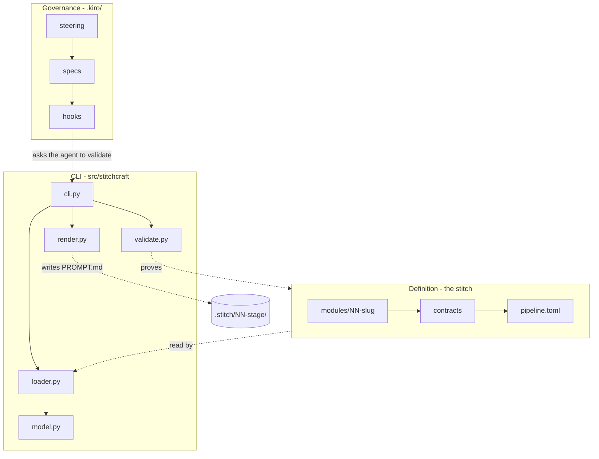

# Stitchcraft Core - Design

This document turns `requirements.md` into an implementation design. Stitchcraft
is data-driven: the stitch is declared in TOML, sealed in JSON Schema, and read by
a small, dependency-free Python CLI that validates, renders and stages work for an
AI agent; the CLI never calls a model, because agents execute module skills.
## Architecture

Five layers, from process to execution:

- **Governance (`.kiro/`)** - steering, specs and hooks; read by the agent, not by the CLI.
- **Modules (`modules/`)** - one skill and one manifest per specialised job.
- **Contracts (`contracts/`)** - the JSON Schemas that define each seam.
- **Pipeline (`pipeline/pipeline.toml`)** - the graph that wires stages together.
- **CLI (`src/stitchcraft/`)** - loads those layers, proves the stitch, renders it and stages dry runs.



Dependencies point one way: governance references the definition, the CLI reads everything, and modules and contracts never know about the CLI or each other.

## Data flow

1. A human or agent writes a raw request, for example `examples/coffee-roastery/request.md`.
2. `stitch run --dry-run` writes one `PROMPT.md` per stage under `.stitch/<NN>-<stage>/`; an agent executes each stage's `SKILL.md`, reads only its consumed artifacts and writes the produced artifact to the path the prompt names.
3. `stitch validate` proves wiring, cycles, artifact ownership and contract shape, and the next stage starts from the artifact, never from the previous conversation.
4. `qa` is a gate: `pass` continues to `deploy`, `conditional` needs a human, `fail` stops the run; `deploy` emits `.stitch/09-deploy/deploy-plan.json`.

The CLI is stateless between runs: every command re-reads the repository from disk,
so artifacts and manifests can be edited by an agent or a human between stages.

## Components

| File | Public surface | Responsibility |
| --- | --- | --- |
| `model.py` | `Project`, `Stage`, `Module`, `Repo`, `Issue` | Frozen dataclasses for the loaded repo and for findings. `Module` exposes `slug` and `skill_path`; `Repo` exposes `module()` and `stage()` lookups. |
| `loader.py` | `find_root()`, `load_repo()`, `load_stages()`, `load_modules()`, `load_contracts()`, `load_schema()`, `LoadError` | Finds the root by walking up to `pipeline/pipeline.toml`, parses TOML, discovers modules from disk and contracts from `contracts/*.schema.json`. Raises `LoadError` when the repo cannot be loaded. |
| `validate.py` | `validate_repo()`, `summarize()`, six `validate_*` layers | Returns every `Issue` without raising: modules, stages, graph, seams, contracts, governance. `summarize()` counts errors and warnings. |
| `render.py` | `mermaid_flow()`, `plan_table()`, `module_table()`, `stage_prompt()` | Renders the graph, the stitch table and one deterministic dry-run prompt per stage. |
| `cli.py` | `build_parser()`, `main()` | Parses `--root` and the subcommands, maps findings to exit codes, prints human or JSON output. Exit codes: `0` success, `1` findings, `2` usage or load errors. |

## Validation rules

Validation is layered so a broken repository reports every problem at once. Codes
are namespaced `<layer>.<rule>`; `error` breaks the stitch, `warning` flags drift.

| Layer | Rule codes | What it proves |
| --- | --- | --- |
| Modules | `module.id.missing`, `module.id.duplicate`, `module.name.missing`, `module.stage.invalid`, `module.slug.mismatch`, `module.produces.empty`, `module.consumes_own_output`, `module.skill.missing` | Manifests are well formed, declare at least one artifact and point at a real skill file. |
| Stages | `stage.id.missing`, `stage.id.duplicate`, `stage.module.missing`, `stage.module.unknown`, `module.unwired`, `module.duplicate_stage` | Every stage wires one module; every module is wired. |
| Graph | `pipeline.self_dependency`, `pipeline.unknown_dependency`, `pipeline.no_entry`, `pipeline.multiple_entry`, `pipeline.cycle`, `pipeline.unreachable` | The dependency graph is acyclic, has an entry stage and is fully reachable. |
| Seams | `seam.duplicate_producer`, `seam.missing_contract`, `seam.unavailable_input`, `seam.no_producer` | Each artifact has exactly one producer, a contract, and reaches every consumer from an ancestor stage. |
| Contracts | `contract.invalid_json`, `contract.not_object`, `contract.missing_key`, `contract.no_properties` | Schemas parse, are JSON objects, declare `$schema`/`title`/`type` and object schemas declare properties. |
| Governance | `governance.steering_missing`, `governance.specs_missing`, `governance.hooks_missing`, `governance.hooks_empty`, `hook.invalid_json`, `hook.not_object`, `hook.missing_keys`, `hook.trigger_invalid`, `hook.patterns_missing`, `hook.action_invalid`, `hook.prompt_missing`, `hook.command_missing` | Steering and a spec exist; every `.kiro.hook` is valid JSON with a known trigger, action and payload. |

`validate --strict` promotes warnings to failures so CI runs with zero tolerance;
`validate --json` prints `{ok, errors, warnings, issues}`, each issue being `{level, code, message, where}`.

## Dry-run prompt

`render.stage_prompt()` composes one plain-text Markdown file per stage. It points
at the skill and the seam instead of inlining instructions, keeping `SKILL.md` the
single source of truth:

```markdown
# Stage 02 — Information Architecture

- Stage: `plan` · Module: `site-plan` · Skill: `modules/02-site-plan/SKILL.md`
- Job: Convert the brief into a page graph, navigation model and content inventory.

## Read
1. `modules/02-site-plan/SKILL.md` — the authoritative procedure for this job.
2. The contracts below, plus the upstream artifacts this stage consumes.

## Seam
- Consumes: `brief` → `contracts/brief.schema.json`, from `.stitch/01-brief/brief.json`
- Produces: `site-plan` → `contracts/site-plan.schema.json`, written to
  `.stitch/02-plan/site-plan.json`

## Do
- Execute only this module's job; record input gaps in `open_questions`.
- Run `python -m stitchcraft validate` and fix anything this stage broke.

## Guardrails
- Never edit another module's artifact; report the defect upstream instead.
- Never weaken `contracts/` to make an artifact pass.
```

## Error taxonomy

- **Load or usage error** - the repo cannot be read (missing pipeline, invalid TOML, no modules) or the command is malformed; stderr, exit `2`, no partial report.
- **Validation error** - `Issue(level="error")`: the stitch is broken; exit `1`.
- **Validation warning** - advisory drift (unreachable stage, contract with no producer); exit `0`, or `1` under `--strict`.
- **Ordering** - findings come in fixed validation-layer and repository order, never filesystem order; messages carry no timestamps or absolute paths.

## Requirements traceability

| Requirement | Where this design answers it |
| --- | --- |
| R1, R2 | `loader.load_modules()` and `load_contracts()` discover manifests from disk; Contracts layer proves schema shape. |
| R3, R4, R5 | Stages, Graph and Seams layers of `validate.py`. |
| R6 | Dry-run prompt section; `render.stage_prompt()` and `cli.cmd_run`. |
| R7, R8 | `cli.py` exit codes; Error taxonomy ordering rule. |
| R9 | `.kiro/steering/tech.md` runtime rules; `pyproject.toml` declares no dependencies. |
| R10, R11 | Governance layer: steering, specs and hook validation. |
| R12, R13 | Delivered by `README.md`, `docs/` and `.github/workflows/ci.yml`; no runtime code involved. |
| R14 | Extension points: new modules are data; loader, validator and renderer iterate what they discover. |

## Extension points

- **New artifact:** contract, then producing module, then pipeline stage; run `stitch validate --strict`.
- **New module:** `modules/<NN>-<slug>/` + contract + `[[stages]]` entry. No Python change (R14).
- **New rule:** `src/stitchcraft/validate.py`, tests, and a matching `.kiro/hooks/` rule so agent and CI run the same check.
- **New renderer or CLI verb:** add to `render.py`/`cli.py` only after requirements and design change; keep output deterministic and model-free.

## Trade-offs

- **Data over code.** Modules and wiring are data, so agents can extend the stitch without Python; the cost is weaker static guarantees than a plugin system.
- **Stdlib only.** No `jsonschema` dependency means `validate` proves contract presence and shape, not artifact instances; content correctness is owned by skills, hooks and the future runner. This keeps the CLI portable and offline (R9).
- **Prompts as files.** `PROMPT.md` keeps the human in the loop and stays agent-agnostic, but Stitchcraft cannot guarantee an agent executes a stage exactly as written.
- **Advisory warnings.** Drift that still executes warns instead of failing so the repo can evolve; CI promotes warnings to failures with `--strict`.
- **No model calls in the core.** The CLI cannot spend money, stall on a provider or leak prompts; that work belongs to the agent reading the prompts.

## Future runner

Milestone M2 adds `stitch run` (without `--dry-run`): a thin orchestrator that
keeps every core guarantee and adds agent adapters.

- For each stage in pipeline order, resolve inputs, assert they exist, hand the stage prompt to an adapter.
- On completion, validate the produced artifact against its JSON Schema (an optional dependency, isolated behind a feature gate).
- Stop at the `qa` gate: `pass` continues, `conditional` needs a human, `fail` stops the run.

```python
class AgentAdapter(Protocol):
    name: str
    def available(self) -> bool: ...
    def run_stage(self, prompt: str, workdir: Path) -> StageResult: ...
# StageResult: ok, produced_paths, transcript_ref, error
```

Planned adapters: Kiro (hooks plus agent task), Claude Code and Codex CLI
(subprocess), and a manual adapter that prints the prompt for a human. The core
CLI stays model-free; vendor behaviour lives in adapters.
