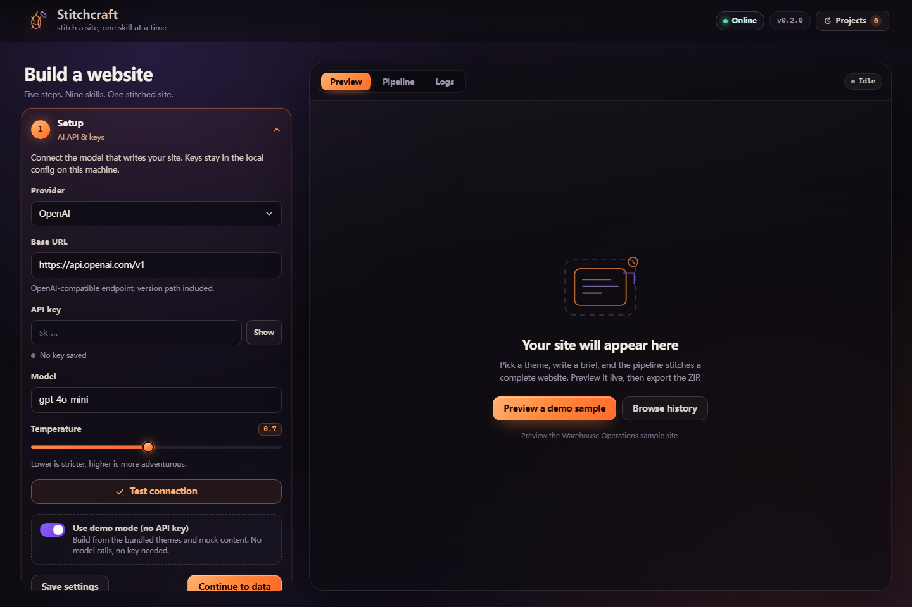
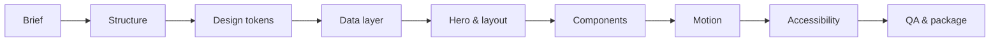

# Stitchcraft

> A solo AI site builder that stitches separate specialised skills into one pipeline — each module does one job, Kiro specs and hooks hold the seams together.

[](https://github.com/RenXiaoxiang/Stitchcraft/actions/workflows/ci.yml)
[](LICENSE)

**Stitchcraft Studio** is a local desktop app that turns one sentence and a
style choice into a complete, previewable static website. Pick a theme
(warehouse operations, staff directory, logistics control, personal space or a
brand launch page), point it at your own AI API, choose where the site's data
lives, and watch a nine-stage pipeline assemble the site from theme modules and
bundled expert skills.

It is built for [Kiroween 2026](https://kiroween.devpost.com/) (Kiro's Halloween
hackathon) in the **Skeleton Crew** category: one skeleton, two very different
apps — a warehouse operations dashboard and a personal space.



## Why

A single long AI session drifts: the design brief leaks into the build prompt,
the data layer is an afterthought, accessibility is skipped and nobody can tell
which step produced which file. Stitchcraft makes every hand-off explicit:

- **One theme, one job.** Five focused theme packages instead of one giant prompt.
- **Modules, not mysteries.** Each theme is `theme.toml` + `SKILL.md` + a data
  model + an optional working sample site.
- **Skills at generation time.** Chrome's Modern Web Guidance, the official GSAP
  skills and web-animation skills are bundled, licensed and injected into the
  generation prompt.
- **Your AI, your data.** Bring any OpenAI-compatible endpoint; choose local
  browser storage or your own remote REST database for the generated site.
- **Kiro holds the seams.** `.kiro/steering`, `.kiro/specs` and `.kiro/hooks`
  keep the repo honest while it is being built.

## What you get

| Feature | Detail |
| --- | --- |
| Desktop launcher | `Stitchcraft.bat` / `启动 Stitchcraft.bat` starts a local server and opens a chromeless Edge app window. No Electron, no build step. |
| AI settings | Provider presets (OpenAI / DeepSeek / OpenRouter / Ollama) or any OpenAI-compatible base URL, API key, model and temperature, with a connection test. Keys stay on your machine. |
| Database choice | **Local**: the generated site persists to browser `localStorage`. **Remote**: enter a REST / Supabase-compatible URL, public anon key and table prefix — the generator embeds them into `data-config.js` and the generated site's CRUD layer talks to it directly. |
| Five themes | `warehouse-ops`, `staff-directory`, `logistics-control`, `personal-space`, `brand-launch` — each with a composition skill and (for two of them) a complete demo site. |
| Nine-stage pipeline | Brief → Structure → Design tokens → Data layer → Hero & layout → Components → Motion → Accessibility → QA & package, streamed into the UI. |
| Demo mode | No API key? Generate from the packaged sample sites so the whole flow still works (and can be recorded for the demo video). |
| Preview & export | Live iframe preview, open in a new tab, export the generated site as a ZIP. |
| Project history | SQLite-backed local history; reopen or delete any generation. |
| Skills runtime | 18 registry entries over three vendored packs plus two house skills; prompt budgets keep generations focused. |

## Quickstart

Requirements: Python 3.11+ (Windows, macOS or Linux), and a modern browser
(Edge gives the chromeless window; others fall back to a normal tab).

```bash
git clone https://github.com/RenXiaoxiang/Stitchcraft.git
cd Stitchcraft
python -m pip install -e .
stitch app                       # starts the studio and opens the window
```

Windows users can also double-click `Stitchcraft.bat` (or `启动 Stitchcraft.bat`).

Inside the studio:

1. **AI API** — pick a provider, paste your key, test the connection
   (or leave it on demo mode).
2. **Data** — choose Local, or Remote and fill in your REST URL + public anon key.
3. **Style** — choose one of the five theme cards.
4. **Brief** — describe the site in a sentence or two.
5. **Generate** — watch the nine stages, then preview and export.

Headless variants:

```bash
stitch generate --theme warehouse-ops --prompt "A warehouse dashboard with inventory CRUD." --engine mock
stitch themes list
stitch skills verify
stitch validate --strict
```

## How a generation works



The generator composes a prompt from four inputs, then validates and writes the
result:

1. **Theme package** — `themes/<id>/SKILL.md` (layout blueprint, components,
   motion and data-layer rules) plus `data-model.json` for data themes.
2. **Bundled skills** — the Modern Web Guidance reference set, official GSAP
   skills (core, timeline, ScrollTrigger, plugins, performance, utils) and
   web-animation skills, each truncated to its prompt budget.
3. **Your brief** — the sentence(s) you typed, plus an optional site title.
4. **Database configuration** — written into the site as
   `window.STITCHCRAFT_DB`; the generated `app.js` reads it and uses a
   `localStorage` adapter or a Supabase-compatible REST adapter.

The AI must answer with a JSON file plan. The generator rejects absolute paths,
`..`, unexpected extensions, oversized files and sites without `index.html`, then
writes the files, injects `data-config.js`, copies the vendored GSAP build when
the site uses it, and streams stage progress + logs to the UI.

## Themes

| Theme | Category | What it builds | Demo sample |
| --- | --- | --- | --- |
| `warehouse-ops` | data | Inventory command center: KPIs, filterable stock table, add/edit/delete, inbound timeline. | ✅ |
| `staff-directory` | data | Employee directory, departments and onboarding tasks. | — |
| `logistics-control` | data | Shipments, carriers and an incident board. | — |
| `personal-space` | personal | Essays, tag filtering, a photo wall and an about page. | ✅ |
| `brand-launch` | brand | Editorial product landing page with hero, proof and CTA. | — |

Shared building blocks live in `themes/_blocks/` (hero, stat grid, data table,
CRUD modal, article list, photo masonry, timeline, CTA band) as reference HTML
the AI can adapt. See [themes/registry.toml](themes/registry.toml) for the
machine-readable list.

## Bundled skills

| Pack | Upstream | License | What it teaches |
| --- | --- | --- | --- |
| Modern Web Guidance | [GoogleChrome/modern-web-guidance](https://github.com/GoogleChrome/modern-web-guidance) | Apache-2.0 | Accessible, modern, high-performance web UI patterns. |
| GSAP official skills | [greensock/gsap-skills](https://github.com/greensock/gsap-skills) | MIT | Correct GSAP timelines, ScrollTrigger, plugins and cleanup. |
| Web Animation Skills | [iart-ai/web-animation-skills](https://github.com/iart-ai/web-animation-skills) | MIT | 60fps budgets, accessible motion, page transitions and micro-interactions. |
| GSAP browser build | [gsap@3.13.0](https://cdn.jsdelivr.net/npm/gsap@3.13.0/dist/gsap.min.js) | GSAP standard license | Offline animation runtime for the studio UI and generated sites. |

Skills are data: `skills/registry.toml` declares paths, license and prompt
budgets; `src/stitchcraft/skills.py` loads and injects them. Attribution is in
[skills/ATTRIBUTION.md](skills/ATTRIBUTION.md); vendored files are never edited
by hand.

## Generated data layer

Every generated site receives a `data-config.js`:

```js
window.STITCHCRAFT_DB = {
  mode: "local",            // "local" | "remote"
  kind: "local",            // "local" | "supabase" | "rest"
  url: "",                  // remote REST base URL
  anonKey: "",              // remote public/anon key only
  tablePrefix: "stitchcraft"
};
```

The theme's data skill writes one adapter with two backends: `localStorage` for
offline/local mode, or Supabase-compatible REST calls
(`${url}/rest/v1/${tablePrefix}_<table>`) for remote mode. Only public/anon keys
belong there — never an AI key, never a service key.

## Kiro integration

The repository is built as a Kiro project, not just with it:

| Layer | Path | Role |
| --- | --- | --- |
| Steering | `.kiro/steering/{product,tech,structure}.md` | Persistent rules every Kiro task loads. |
| Specs | `.kiro/specs/stitchcraft-core/`, `.kiro/specs/desktop-studio/` | Requirements (EARS) → design → tasks for the pipeline and the desktop studio. |
| Hooks | `.kiro/hooks/*.kiro.hook` | File-edit checks: seam check, module anatomy, spec sync, skill registry, theme anatomy, desktop smoke test, manual pipeline gate. |
| Validation | `stitch validate --strict` | Proves modules, contracts, pipeline, hooks, themes and skills still agree. |

`python -m stitchcraft validate --strict` is the single command that keeps the
whole repository coherent; the hooks call it whenever a seam changes.

## Repository layout

```text
.
├── 启动 Stitchcraft.bat / Stitchcraft.bat   desktop launcher
├── app/web/                                 local studio UI (vanilla JS + vendored GSAP)
├── src/stitchcraft/                         stdlib backend + CLI
├── themes/                                  theme packages + _blocks + registry
├── skills/                                  vendored skill packs + registry + attribution
├── modules/ contracts/ pipeline/            the original nine-module stitch spine
├── .kiro/                                   steering, specs and hooks
├── hackathon/                               Kiroween 2026 submission kit
├── docs/                                    architecture/authoring/roadmap + Pages showcase
├── tests/                                   unit tests + API smoke tests
├── 开发文档.txt                              full development plan (Chinese)
└── examples/                                seed requests for dry runs
```

## Development

```bash
python -m unittest discover -s tests -v                      # unit + API tests
PYTHONPATH=src python -m stitchcraft validate --strict       # repository invariants
python -m stitchcraft app --smoke-test --no-window           # headless end-to-end studio test
python -m stitchcraft themes verify
python -m stitchcraft skills verify
```

CI runs the same checks on Python 3.11, 3.12 and 3.13. Read
[AGENTS.md](AGENTS.md) before changing anything: the rules apply to humans and
AI agents alike.

## Privacy and security

- The studio binds to `127.0.0.1` only.
- AI keys and database credentials are stored in your app-data directory
  (`%LOCALAPPDATA%\Stitchcraft\config.json`), never in the repo, logs or
  generated sites.
- Generated files are sandboxed: relative paths, extension whitelist, size caps.
- No telemetry. No network calls except the AI endpoint you configure.

## Kiroween 2026

- Category: **Skeleton Crew** (one skeleton, two apps); Frankenstein flavor
  (Kiro + Chrome guidance + GSAP + bring-your-own AI) and Costume Contest styling.
- Submission materials, video storyboard and compliance checklist live in
  [hackathon/](hackathon/).
- Demo URL (GitHub Pages showcase): https://renxiaoxiang.github.io/Stitchcraft/

## 中文说明

Stitchcraft 是一个本地桌面应用：选一个网站主题，用一句话描述需求，接入你自己的
AI API，就能生成一个完整、可预览、可导出的网站。

- **桌面启动**：双击 `启动 Stitchcraft.bat`，在 Edge 应用窗口里使用，无需浏览器地址栏。
- **自带 AI**：OpenAI / DeepSeek / OpenRouter / Ollama / 任意 OpenAI 兼容接口；
  Key 只存在本机配置里。
- **本地 / 远端数据库**：选本地时生成站点用浏览器 localStorage；选远端时填入数据库
  URL 与公开 anon key，配置会被写进生成站点，站点的增删改查直接访问它。
- **风格主题**：仓储管理、人员管理、后勤管理、个人空间、品牌落地页。
- **内置技能**：Chrome 官方 Modern Web Guidance、GSAP 官方 skills、web-animation
  skills，生成时自动注入提示词。
- **零 Key 演示**：演示模式内置两个成品站（仓储看板、个人空间），断网也能完整演示。
- **参赛**：Kiroween 2026（Skeleton Crew 赛道），提交材料见 `hackathon/`。

完整开发计划见 [`开发文档.txt`](开发文档.txt)。

## License

[MIT](LICENSE) © 2026 RenXiaoxiang

Kiro and Kiroween are trademarks of Amazon Web Services. GSAP and GreenSock are
trademarks of GreenSock, Inc. Chrome and Google are trademarks of Google LLC.
Third-party skills are used under their upstream licenses; see
[skills/ATTRIBUTION.md](skills/ATTRIBUTION.md).
