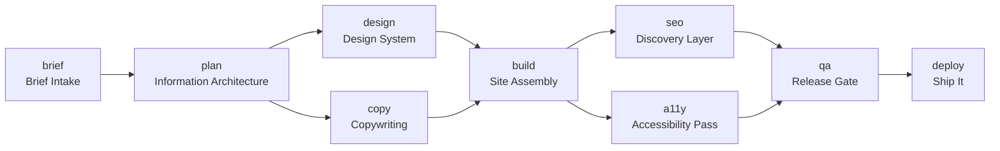

# Stitchcraft

> A solo AI site builder that stitches separate specialised skills into one pipeline — each module does one job, Kiro specs and hooks hold the seams together.

[](https://github.com/RenXiaoxiang/Stitchcraft/actions/workflows/ci.yml)

Stitchcraft is an open toolset for building a complete marketing, landing or
small-business website with an AI agent. Instead of asking one generalist model
to design, write, build, optimise and ship a site in one long conversation, it
splits the work into nine specialised modules that pass **contract-checked
artifacts** to each other. An agent can do one module well, then hand over.

## Why

A single long agent session drifts. Context rots, the design brief leaks into
the build prompt, SEO gets bolted on at the end, and nobody can tell which step
produced which file. Stitchcraft makes the hand-offs explicit:

- **One module, one job.** Nine small skills instead of one giant prompt.
- **Artifacts, not conversations.** Every hand-off is a JSON file, written by
  one module and read by the next.
- **Contracts at every seam.** `contracts/*.schema.json` defines the minimum a
  downstream module may rely on.
- **Specs before code.** Kiro specs describe what the pipeline must do, and the
  agent implements against them.
- **Hooks hold the seams.** Kiro agent hooks re-validate the stitch whenever a
  module, contract or pipeline stage is edited.

## The stitch



| Stage | Module | Job | Produces |
| --- | --- | --- | --- |
| 1 | `brief` | Turn a raw request into a sealed brief: audience, goals, constraints, open questions. | `brief` |
| 2 | `site-plan` | Build the page graph, navigation and content inventory from the brief. | `site-plan` |
| 3 | `design-system` | Choose the visual direction and emit reusable design tokens. | `design-tokens` |
| 4 | `copy` | Write every page section against the plan and the brand voice. | `page-content` |
| 5 | `build` | Assemble routes, components and build settings into a static site manifest. | `build-manifest` |
| 6 | `seo` | Fill metadata, structured data, sitemap and robots policy for the built site. | `seo-report` |
| 7 | `a11y` | Audit the site against WCAG 2.2 AA and return the patches the build must absorb. | `a11y-audit` |
| 8 | `qa` | Run the release gate: build, links, performance and accessibility verdict. | `qa-report` |
| 9 | `deploy` | Produce a reproducible deploy plan with environment, domain and rollback steps. | `deploy-plan` |

Stage 8 is a **gate**: nothing downstream can ship until the QA verdict passes.

## What holds it together

| Layer | Location | Role |
| --- | --- | --- |
| Modules | `modules/<NN-slug>/` | `SKILL.md` (the job) + `module.toml` (the contract it consumes/produces). |
| Seams | `contracts/*.schema.json` | JSON Schema for every artifact; the only thing allowed to cross a stage boundary. |
| Wiring | `pipeline/pipeline.toml` | Stage order, dependencies and gates — the single source of truth for the stitch. |
| Specs | `.kiro/specs/stitchcraft-core/` | Requirements, design and tasks in Kiro's spec format. |
| Guardrails | `.kiro/steering/` | Persistent rules an agent reads on every task. |
| Enforcement | `.kiro/hooks/*.kiro.hook` | Agent hooks that re-check seams on file edits, plus a manual validate gate. |
| Checker | `src/stitchcraft/` | Dependency-free CLI: load, validate, render, stage dry runs. |

## Quickstart

Requirements: Python 3.11+ and Git.

```bash
git clone https://github.com/RenXiaoxiang/Stitchcraft.git
cd Stitchcraft
python -m pip install -e .

stitch doctor            # toolchain and repo health
stitch validate --strict # proves the stitch holds
stitch plan              # renders the graph above
stitch run --dry-run     # stages one PROMPT.md per module under .stitch/
```

Prefer not to install anything? Run the CLI from the source tree:

```bash
PYTHONPATH=src python -m stitchcraft validate --strict   # macOS / Linux
set PYTHONPATH=src && python -m stitchcraft validate --strict   # Windows (cmd)
```

## CLI

| Command | What it does |
| --- | --- |
| `stitch list` | Lists stages, modules, artifacts and dependencies. |
| `stitch show <module>` | Shows one module's manifest, skill path and seam. |
| `stitch validate [--strict] [--json]` | Validates modules, wiring, cycles, artifacts, contracts and Kiro hooks. |
| `stitch plan [--mermaid-only]` | Renders the stitch as a Mermaid graph plus a table. |
| `stitch doctor` | Checks Python version, contracts, steering, hooks, specs and tests. |
| `stitch run --dry-run` | Writes one `PROMPT.md` per stage; makes **no** model calls. |

The CLI is deterministic and offline by design. It prepares the seams; the
agent executes the modules.

## Working with Kiro

1. Open this folder in Kiro. The files in `.kiro/steering/` load as persistent
   context and `.kiro/hooks/` are available as agent hooks.
2. Read `.kiro/specs/stitchcraft-core/requirements.md` and `design.md` — that is
   the contract between you and the repo.
3. `stitch run --dry-run`, then point Kiro at `.stitch/01-brief/PROMPT.md`.
4. After each stage, run `stitch validate` and fix seam errors before moving on.
5. The QA gate (`08-qa`) is a human decision: review the verdict before the
   deploy module plans a release.

See [docs/kiro-workflow.md](docs/kiro-workflow.md) for a full walkthrough.

## Repository layout

```text
.
├── .kiro/                 # steering, specs and hooks (Kiro governance layer)
├── contracts/             # JSON Schema for every artifact — the seams
├── modules/               # nine specialised skills, one job each
├── pipeline/pipeline.toml # stage wiring: order, dependencies, gates
├── src/stitchcraft/       # the dependency-free `stitch` CLI
├── tests/                 # repo-health smoke tests
├── docs/                  # architecture, authoring, Kiro workflow, roadmap
├── examples/              # seed requests for dry runs
├── AGENTS.md              # rules for AI agents working in this repo
├── pyproject.toml         # packaging and console entry point
└── .github/workflows/     # CI: tests + validate + plan + dry run
```

## Principles

1. **One module, one job.** If a skill starts doing two jobs, split it.
2. **Artifacts, not conversations.** No module reads another module's notes.
3. **Contracts at the seam.** Weakening a schema to silence the validator is a bug.
4. **Specs before code.** Requirements and design precede implementation.
5. **Boring, portable tech.** Python standard library, JSON, Markdown, static HTML.
6. **Agent-agnostic.** Kiro is the reference workflow, not a hard dependency.

## Status

`v0.1` is the scaffold: pipeline, nine module skills, nine artifact contracts,
the Kiro governance layer, a validating CLI, tests and CI. The agent runner,
site compiler and deploy adapters are planned — see
[docs/roadmap.md](docs/roadmap.md). This is a foundation to build on, not a
finished site generator.

## 中文说明

Stitchcraft 是一个「一个人 + AI 就能建站」的流水线工具集。它不指望一个通用
AI 从头到尾包办整站，而是把建站拆成 9 个只做一件事的专业模块：

`需求简报 → 站点结构 → 设计系统 → 文案 → 页面构建 → SEO → 无障碍 → QA 验收 → 部署`

- **每个模块** = `SKILL.md`（给 AI 的操作手册）+ `module.toml`（声明它读什么、产出什么）。
- **模块之间只传 JSON 工件**，工件由 `contracts/` 里的 JSON Schema 约束，接缝不会漏信息。
- **Kiro 的 steering / specs / hooks** 负责把接缝焊死：改契约会触发校验，QA 通过才允许部署。

快速开始：克隆仓库 → `pip install -e .` → `stitch validate --strict` →
`stitch run --dry-run`，然后在 Kiro 里按 `.stitch/` 下生成的提示逐模块执行。

## Contributing

Issues and pull requests are welcome. Before opening a PR:

```bash
python -m unittest discover -s tests -v
stitch validate --strict
```

Keep the CLI dependency-free and read [AGENTS.md](AGENTS.md) first — the rules
there apply to humans and agents alike.

## License

[MIT](LICENSE) © 2026 RenXiaoxiang
