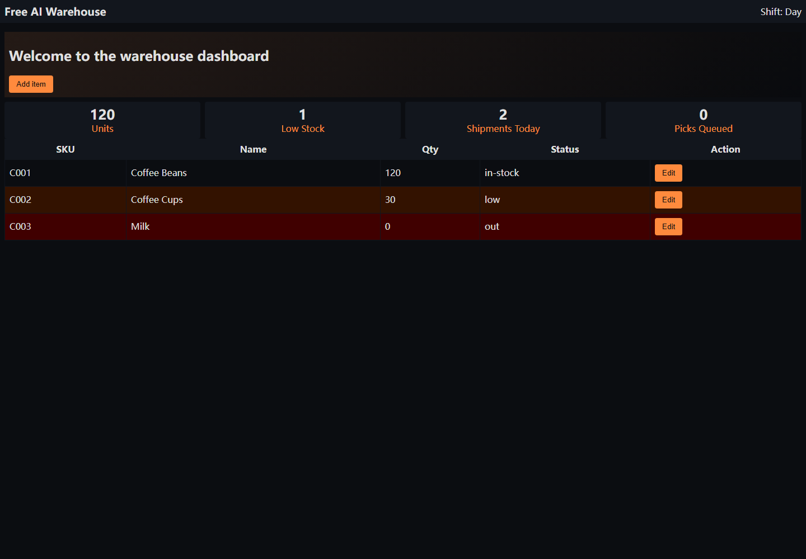
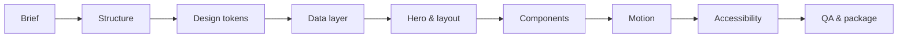

# Stitchcraft

> A solo AI site builder that stitches separate specialised skills into one pipeline — each module does one job, Kiro specs and hooks hold the seams together.

[](https://github.com/RenXiaoxiang/Stitchcraft/actions/workflows/ci.yml)
[](LICENSE)

**Stitchcraft Studio** is a local desktop app that turns one sentence and a
style choice into a complete, previewable static website. Pick a theme
(warehouse operations, staff directory, logistics control, personal space or a
brand launch page), point it at your own AI API, choose where the site's data
lives, and watch a nine-stage pipeline assemble the site from theme modules and
bundled expert skills.

It is built for [Kiroween 2026](https://kiroween.devpost.com/) (Kiro's Halloween
hackathon) in the **Skeleton Crew** category: one skeleton, two very different
apps — a warehouse operations dashboard and a personal space.


## Why

A single long AI session drifts: the design brief leaks into the build prompt,
the data layer is an afterthought, accessibility is skipped and nobody can tell
which step produced which file. Stitchcraft makes every hand-off explicit:

- **One theme, one job.** Five focused theme packages instead of one giant prompt.
- **Modules, not mysteries.** Each theme is `theme.toml` + `SKILL.md` + a data
  model + an optional working sample site.
- **Skills at generation time.** Chrome's Modern Web Guidance, the official GSAP
  skills and web-animation skills are bundled, licensed and injected into the
  generation prompt.
- **Your AI, your data.** Bring any OpenAI-compatible endpoint; choose local
  browser storage or your own remote REST database for the generated site.
- **Kiro holds the seams.** `.kiro/steering`, `.kiro/specs` and `.kiro/hooks`
  keep the repo honest while it is being built.

## What you get

| Feature | Detail |
| --- | --- |
| Desktop launcher | `Stitchcraft.bat` / `启动 Stitchcraft.bat` starts a local server and opens a chromeless Edge app window. No Electron, no build step. |
| AI settings | Free and paid providers built in: **Pollinations** (no key at all), **智谱 GLM-4-Flash** (permanently free, China-friendly), **SiliconFlow** free models, **GitHub Models** (free quota with your GitHub account), plus Gemini / Groq / OpenRouter free tiers, local Ollama, or any OpenAI-compatible endpoint with your own key. Connection test included; keys stay on your machine. |
| Database choice | **Local**: the generated site persists to browser `localStorage`. **Remote**: enter a REST / Supabase-compatible URL, public anon key and table prefix — the generator embeds them into `data-config.js` and the generated site's CRUD layer talks to it directly. |
| Five themes | `warehouse-ops`, `staff-directory`, `logistics-control`, `personal-space`, `brand-launch` — each with a composition skill and (for two of them) a complete demo site. |
| Nine-stage pipeline | Brief → Structure → Design tokens → Data layer → Hero & layout → Components → Motion → Accessibility → QA & package, streamed into the UI. |
| Demo mode | No API key? Generate from the packaged sample sites so the whole flow still works (and can be recorded for the demo video). |
| Preview & export | Live iframe preview, open in a new tab, export the generated site as a ZIP. |
| Project history | SQLite-backed local history; reopen or delete any generation. |
| Skills runtime | 21 registry entries over four vendored packs plus three house skills; prompt budgets keep generations focused. |
| Aggregated tool packs | Six MIT-licensed browser libraries (Fabric.js, Chart.js, SortableJS, Rough.js, Swiper, GridStack) vendored under `vendor/` with LICENSE + UPSTREAM.md; a theme declares the ones it needs and a generated site receives only the libraries it references under `site/vendor/<id>/` — offline, no CDN. |
| Built-in AI browser | Optional Obscura runtime (Apache-2.0, ~70 MB) downloaded on demand and verified with SHA-256; it screenshots each generated site and records a DOM audit (title, headings, links, image alt coverage), so checks still work on machines without Chrome or Edge. |

## Free AI options (no paid key needed)

You do **not** need a paid API key. The studio ships with several free routes,
selectable in **Setup → Provider**:

| Provider | What it costs | Setup |
| --- | --- | --- |
| **Pollinations** (default) | **Free, no key** (community endpoint) | Nothing — select it and generate. The free tier allows roughly one request per 30s and shorter output, so it builds a compact single-file site. |
| **智谱 GLM-4-Flash** | **Permanently free** model, China-friendly | Register at [open.bigmodel.cn](https://open.bigmodel.cn/), create a free API key, paste it. Recommended when you want reliable free generations. |
| **SiliconFlow 免费模型** | Some small models are ¥0, China-friendly | Register at [cloud.siliconflow.cn](https://cloud.siliconflow.cn/), create a free key, keep or change the model id. |
| **GitHub Models** | Free quota with your GitHub account | Create a PAT with the `models: read` scope at [github.com/settings/tokens](https://github.com/settings/tokens) and paste it. |
| **Ollama** | **Free, local, private** | Install [Ollama](https://ollama.com/), run `ollama serve`, `ollama pull llama3.1`; the studio auto-detects local models. |
| **Groq / Gemini / OpenRouter** | Free tiers (may need a proxy from mainland China) | Create a free key at the provider and paste it. |
| **OpenAI / DeepSeek** | Paid | Optional: bring your own paid key. DeepSeek's official API is **not free** (low cost, requires top-up). |
| **Demo mode** | Free, no model calls | Toggle it on to generate from the packaged sample sites — always available offline. |

Free-keyless and small-model providers use a **compact single-file generation
mode** (inline CSS/JS, ~one `index.html`) so the output fits their limits. For
the richest multi-page output, use a capable model or the two demo samples.

```text
No key at all?      Pollinations (try)  →  Ollama (local)
Reliable + free:    智谱 GLM-4-Flash  ·  GitHub Models  ·  SiliconFlow
Offline demo:       toggle "Use demo mode (no API key)"
```



## Quickstart

Requirements: Python 3.11+ (Windows, macOS or Linux), and a modern browser
(Edge gives the chromeless window; others fall back to a normal tab).

```bash
git clone https://github.com/RenXiaoxiang/Stitchcraft.git
cd Stitchcraft
python -m pip install -e .
stitch app                       # starts the studio and opens the window
```

Windows users can also double-click `Stitchcraft.bat` (or `启动 Stitchcraft.bat`).

Inside the studio:

1. **AI API** — pick a provider, paste your key, test the connection
   (or leave it on demo mode).
2. **Data** — choose Local, or Remote and fill in your REST URL + public anon key.
3. **Style** — choose one of the five theme cards.
4. **Brief** — describe the site in a sentence or two.
5. **Generate** — watch the nine stages, then preview and export.

Headless variants:

```bash
stitch generate --theme warehouse-ops --prompt "A warehouse dashboard with inventory CRUD." --engine mock
stitch themes list
stitch skills verify
stitch validate --strict
```

## How a generation works



The generator composes a prompt from four inputs, then validates and writes the
result:

1. **Theme package** — `themes/<id>/SKILL.md` (layout blueprint, components,
   motion and data-layer rules) plus `data-model.json` for data themes.
2. **Bundled skills** — the Modern Web Guidance reference set, official GSAP
   skills (core, timeline, ScrollTrigger, plugins, performance, utils) and
   web-animation skills, each truncated to its prompt budget.
3. **Your brief** — the sentence(s) you typed, plus an optional site title.
4. **Database configuration** — written into the site as
   `window.STITCHCRAFT_DB`; the generated `app.js` reads it and uses a
   `localStorage` adapter or a Supabase-compatible REST adapter.

The AI must answer with a JSON file plan. The generator rejects absolute paths,
`..`, unexpected extensions, oversized files and sites without `index.html`, then
writes the files, injects `data-config.js`, copies the vendored GSAP build when
the site uses it, and streams stage progress + logs to the UI.

## Themes

| Theme | Category | What it builds | Demo sample |
| --- | --- | --- | --- |
| `warehouse-ops` | data | Inventory command center: KPIs, filterable stock table, add/edit/delete, inbound timeline. | ✅ |
| `staff-directory` | data | Employee directory, departments and onboarding tasks. | — |
| `logistics-control` | data | Shipments, carriers and an incident board. | — |
| `personal-space` | personal | Essays, tag filtering, a photo wall and an about page. | ✅ |
| `brand-launch` | brand | Editorial product landing page with hero, proof and CTA. | — |

Shared building blocks live in `themes/_blocks/` (hero, stat grid, data table,
CRUD modal, article list, photo masonry, timeline, CTA band) as reference HTML
the AI can adapt. See [themes/registry.toml](themes/registry.toml) for the
machine-readable list.

## Bundled skills

| Pack | Upstream | License | What it teaches |
| --- | --- | --- | --- |
| Modern Web Guidance | [GoogleChrome/modern-web-guidance](https://github.com/GoogleChrome/modern-web-guidance) | Apache-2.0 | Accessible, modern, high-performance web UI patterns. |
| AI Design Skills | [elayadesign/ai-design-skills](https://github.com/elayadesign/ai-design-skills) | MIT | Conversion-first landing-page structure and a strict visual system for marketing pages. |
| GSAP official skills | [greensock/gsap-skills](https://github.com/greensock/gsap-skills) | MIT | Correct GSAP timelines, ScrollTrigger, plugins and cleanup. |
| Web Animation Skills | [iart-ai/web-animation-skills](https://github.com/iart-ai/web-animation-skills) | MIT | 60fps budgets, accessible motion, page transitions and micro-interactions. |
| GSAP browser build | [gsap@3.13.0](https://cdn.jsdelivr.net/npm/gsap@3.13.0/dist/gsap.min.js) | GSAP standard license | Offline animation runtime for the studio UI and generated sites. |

Skills are data: `skills/registry.toml` declares paths, license and prompt
budgets; `src/stitchcraft/skills.py` loads and injects them. Attribution is in
[skills/ATTRIBUTION.md](skills/ATTRIBUTION.md); vendored files are never edited
by hand.

## Aggregated open-source tools

Some sites need a canvas, a chart, a carousel or a dashboard grid, and asking the
model to re-invent those browser primitives on every generation produces fragile
code. Stitchcraft therefore vendors six proven, MIT-licensed browser libraries
under `vendor/<id>/` and lets a theme request them. The files are pinned,
unmodified and licensed; a generated site needs no network access to use them.

| Library | Version | License | What generated sites can build with it |
| --- | --- | --- | --- |
| [Fabric.js](https://github.com/fabricjs/fabric.js) | 5.2.4 | MIT | Interactive canvas: freehand drawing, shapes, text and object manipulation for whiteboards, planners and annotation tools. |
| [Chart.js](https://github.com/chartjs/Chart.js) | 4.4.7 | MIT | Responsive bar, line, radar and doughnut charts for KPI panels and reports. |
| [SortableJS](https://github.com/SortableJS/Sortable) | 1.15.6 | MIT | Touch-friendly drag-and-drop reordering for lists, tables and kanban boards. |
| [Rough.js](https://github.com/pshihn/rough) | 4.6.6 | MIT | Hand-drawn, sketch-style shapes and lines on canvas and SVG. |
| [Swiper](https://github.com/nolimits4web/swiper) | 11.2.6 | MIT | Touch carousels, sliders and gallery layouts with keyboard support. |
| [GridStack](https://github.com/gridstack/gridstack.js) | 10.3.1 | MIT | Draggable, resizable dashboard grids for analytics boards. |

### Whiteboard demo

[docs/demo/whiteboard/index.html](docs/demo/whiteboard/index.html) is a working
Fabric.js whiteboard that runs offline: draw with the pen and highlighter, add
shapes and text, undo, let autosave keep the board, then export a PNG. It loads
the same vendored `fabric.min.js` a generated site would use, so the demo doubles
as proof of the offline path.


[Open the whiteboard demo](docs/demo/whiteboard/index.html) ·
[Read the whiteboard skill](skills/house/stitchcraft-whiteboard/SKILL.md)

### Libraries at runtime

```bash
stitch libraries list            # every vendored library, version and license
stitch libraries show fabric     # one library's files, upstream record and entry points
stitch libraries verify          # LICENSE, UPSTREAM.md, README.md and registry agree
```

The local studio also serves `GET /api/libraries`, so the UI and scripts read the
same index. A theme package may declare the libraries it is allowed to use
(`libraries = ["fabric", "chartjs"]` in `theme.toml`); the generator copies only
the libraries the generated site actually references into `site/vendor/<id>/`,
straight from the vendored dist files. Unreferenced libraries never enter an
export, and generated sites never point at a CDN.

### Licensing

The vendor layer is MIT-only by design. Every `vendor/<id>/` folder keeps the
upstream `LICENSE`, a `UPSTREAM.md` record (repository, pinned npm version,
download URL, SPDX id, copyright line, copied files with SHA-256, vendored date)
and a `README.md` describing what the library offers and the exact relative
`<script>`/`<link>` paths a generated site should use. Distributed files are
byte-for-byte copies of the pinned upstream release: license and copyright lines
are preserved, the machine-readable index lives in `vendor/registry.toml`, and no
CDN is contacted at runtime.

[THIRD_PARTY_NOTICES.md](THIRD_PARTY_NOTICES.md) is the canonical index for all
third-party material in Stitchcraft — this vendor layer, the bundled skills, the
GoogleChrome/modern-web-guidance pack (Apache-2.0, Google LLC attribution), the
GSAP packs and their standard license, plus every license text. The
human-readable companion for the six libraries is
[vendor/ATTRIBUTION.md](vendor/ATTRIBUTION.md). Adding, upgrading or removing a
third-party file starts and ends in those two files.

## Built-in AI browser (Obscura)

Stitchcraft can give the AI its own browser instead of assuming the customer has
a modern Chrome or Edge installed. On first use the studio downloads
[Obscura](https://github.com/h4ckf0r0day/obscura) — a ~70 MB, Apache-2.0
headless browser written in Rust — into the app-data directory, verifies the
release against pinned SHA-256 digests, and drives it locally. Nothing is
bundled in the repository and nothing is uploaded: the runtime stays on the
machine, renders with its own engine, and records a screenshot plus a small DOM
audit for every build.


```bash
stitch browser status            # platform, version, license, installed/path
stitch browser install           # download + SHA-256 verification + extraction
stitch browser check --url URL   # render a page, screenshot it, audit title/h1/links/alts
stitch browser serve --port 9222 # CDP server for Playwright / Puppeteer / agents
stitch browser mcp               # MCP server (browser_navigate, browser_screenshot, ...)
stitch browser remove            # delete the local runtime and its checks
```

In the studio, step 1 has an **AI browser** card (install / remove / automatic
check toggle), and the **AI browser** tab shows the latest screenshot and audit.
If the runtime is not installed the generation still succeeds; the check is
skipped and the UI says so. The check is local-only: Obscura is started with
`--allow-private-network` so it can reach `127.0.0.1`, never a remote service.

- **Platforms:** Windows x86_64, Linux x86_64/aarch64, macOS Intel/Apple silicon.
- **License:** Apache-2.0. The license and notice are written next to the
  downloaded runtime; the notice index is
  [THIRD_PARTY_NOTICES.md](THIRD_PARTY_NOTICES.md).
- **Slow GitHub?** Set `STITCHCRAFT_BROWSER_MIRROR=https://gh-proxy.com` (or a
  `{url}` template) before installing; the SHA-256 check still applies.
- **No background daemon:** the CLI starts the runtime per check and exits; the
  server only invokes it during a build or a manual check.

## Generated data layer

Every generated site receives a `data-config.js`:

```js
window.STITCHCRAFT_DB = {
  mode: "local",            // "local" | "remote"
  kind: "local",            // "local" | "supabase" | "rest"
  url: "",                  // remote REST base URL
  anonKey: "",              // remote public/anon key only
  tablePrefix: "stitchcraft"
};
```

The theme's data skill writes one adapter with two backends: `localStorage` for
offline/local mode, or Supabase-compatible REST calls
(`${url}/rest/v1/${tablePrefix}_<table>`) for remote mode. Only public/anon keys
belong there — never an AI key, never a service key.

## Kiro integration

The repository is built as a Kiro project, not just with it:

| Layer | Path | Role |
| --- | --- | --- |
| Steering | `.kiro/steering/{product,tech,structure}.md` | Persistent rules every Kiro task loads. |
| Specs | `.kiro/specs/stitchcraft-core/`, `.kiro/specs/desktop-studio/` | Requirements (EARS) → design → tasks for the pipeline and the desktop studio. |
| Hooks | `.kiro/hooks/*.kiro.hook` | File-edit checks: seam check, module anatomy, spec sync, skill registry, theme anatomy, desktop smoke test, manual pipeline gate. |
| Validation | `stitch validate --strict` | Proves modules, contracts, pipeline, hooks, themes and skills still agree. |

`python -m stitchcraft validate --strict` is the single command that keeps the
whole repository coherent; the hooks call it whenever a seam changes.

## Repository layout

```text
.
├── 启动 Stitchcraft.bat / Stitchcraft.bat   desktop launcher
├── app/web/                                 local studio UI (vanilla JS + vendored GSAP)
├── src/stitchcraft/                         stdlib backend + CLI
│   ├── browser.py                           optional Obscura AI browser (download-on-demand)
│   └── data/                                Obscura Apache-2.0 license + notice snapshots
├── themes/                                  theme packages + _blocks + registry
├── skills/                                  vendored skill packs + registry + attribution
├── vendor/                                  six MIT browser libraries + registry + attribution
├── modules/ contracts/ pipeline/            the original nine-module stitch spine
├── .kiro/                                   steering, specs and hooks
├── hackathon/                               Kiroween 2026 submission kit
├── docs/                                    architecture/authoring/roadmap + Pages showcase
│   ├── demo/whiteboard/                     offline Fabric.js whiteboard demo
│   └── integrations/                        optional Playwright MCP setup
├── tests/                                   unit tests + API smoke tests
├── 开发文档.txt                              full development plan (Chinese)
└── examples/                                seed requests for dry runs
```

## Development

```bash
python -m unittest discover -s tests -v                      # unit + API tests
PYTHONPATH=src python -m stitchcraft validate --strict       # repository invariants
python -m stitchcraft app --smoke-test --no-window           # headless end-to-end studio test
python -m stitchcraft browser status                         # optional AI browser (Obscura)
python -m stitchcraft themes verify
python -m stitchcraft skills verify
```

CI runs the same checks on Python 3.11, 3.12 and 3.13. Read
[AGENTS.md](AGENTS.md) before changing anything: the rules apply to humans and
AI agents alike.

- [`.kiro/steering/lean-engineering.md`](.kiro/steering/lean-engineering.md) —
  necessity-first engineering guardrails (inspired by Ponytail, MIT).
- [`docs/integrations/playwright-mcp.md`](docs/integrations/playwright-mcp.md) —
  optional Playwright MCP setup for interactive E2E tests; not bundled and not
  required at runtime.

## Privacy and security

- The studio binds to `127.0.0.1` only.
- AI keys and database credentials are stored in your app-data directory
  (`%LOCALAPPDATA%\Stitchcraft\config.json`), never in the repo, logs or
  generated sites.
- Generated files are sandboxed: relative paths, extension whitelist, size caps.
- No telemetry. No network calls except the AI endpoint you configure.

## Kiroween 2026

- Category: **Skeleton Crew** (one skeleton, two apps); Frankenstein flavor
  (Kiro + Chrome guidance + GSAP + bring-your-own AI) and Costume Contest styling.
- Submission materials, video storyboard and compliance checklist live in
  [hackathon/](hackathon/).
- Demo URL (GitHub Pages showcase): https://renxiaoxiang.github.io/Stitchcraft/

## 中文说明

Stitchcraft 是一个本地桌面应用：选一个网站主题，用一句话描述需求，接入你自己的
AI API，就能生成一个完整、可预览、可导出的网站。

- **桌面启动**：双击 `启动 Stitchcraft.bat`，在 Edge 应用窗口里使用，无需浏览器地址栏。
- **自带 AI**：OpenAI / DeepSeek / OpenRouter / Ollama / 任意 OpenAI 兼容接口；
  Key 只存在本机配置里。
- **本地 / 远端数据库**：选本地时生成站点用浏览器 localStorage；选远端时填入数据库
  URL 与公开 anon key，配置会被写进生成站点，站点的增删改查直接访问它。
- **风格主题**：仓储管理、人员管理、后勤管理、个人空间、品牌落地页。
- **内置技能**：Chrome 官方 Modern Web Guidance、GSAP 官方 skills、web-animation
  skills，生成时自动注入提示词。
- **零 Key 演示**：演示模式内置两个成品站（仓储看板、个人空间），断网也能完整演示。
- **参赛**：Kiroween 2026（Skeleton Crew 赛道），提交材料见 `hackathon/`。

完整开发计划见 [`开发文档.txt`](开发文档.txt)。

## License

[MIT](LICENSE) © 2026 RenXiaoxiang

Kiro and Kiroween are trademarks of Amazon Web Services. GSAP and GreenSock are
trademarks of GreenSock, Inc. Chrome and Google are trademarks of Google LLC.
Other names, including the six vendored JavaScript libraries, are the property
of their respective owners. Third-party skills and libraries are used under
their upstream licenses; see [THIRD_PARTY_NOTICES.md](THIRD_PARTY_NOTICES.md)
for the canonical index, [skills/ATTRIBUTION.md](skills/ATTRIBUTION.md) for the
skill packs and [vendor/ATTRIBUTION.md](vendor/ATTRIBUTION.md) for the vendored
libraries.
