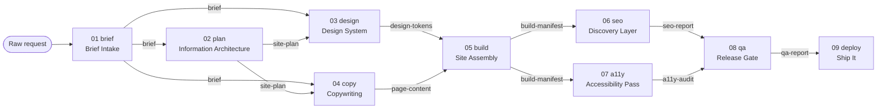

# Architecture

Stitchcraft builds a site the way a small studio would: nine specialists, each
with one job, passing signed-off work to the next. The implementation of that
idea is deliberately small — a TOML graph, JSON Schema contracts, nine Markdown
skills and a dependency-free Python CLI that checks the seams.

## Why the stitch model

### One long agent session rots

Ask a single agent to run intake, information architecture, design, copy, build,
SEO, accessibility, QA and deploy in one context window and quality degrades
predictably:

- **Context rot.** By the time the hero is written, the audience is three
  summarisations old. The brief that started the session no longer influences
  the page.
- **No boundary between jobs.** One generalist does every stage "well enough".
  A specialist with one job and one output format does that job better.
- **No evidence.** Nothing downstream can prove what it was handed or which
  decision produced which file.
- **Silent seam failures.** Copy ignores the plan, the build ignores the tokens,
  QA finds the defect accessibility was supposed to catch.

Stitchcraft makes each hand-off explicit. A module is a `SKILL.md` procedure
plus a `module.toml` manifest that names the artifacts it consumes and produces.
A module never imports another module, never reads its prompt and never reaches
back to the client request once the brief is sealed.

The only thing that crosses a stage boundary is a JSON artifact validated
against a schema in `contracts/`. Contracts state the *minimum* downstream
modules need; producers may carry richer evidence forward without breaking the
seam. This is what makes modules replaceable: a different model, agent or human
can do the same job and still satisfy the consumer.

## The pipeline



| # | Stage id | Module | Consumes | Produces | Gate |
| --- | --- | --- | --- | --- | --- |
| 1 | `brief` | Brief Intake | — | `brief` | |
| 2 | `plan` | Information Architecture | `brief` | `site-plan` | |
| 3 | `design` | Design System | `brief`, `site-plan` | `design-tokens` | |
| 4 | `copy` | Copywriting | `brief`, `site-plan` | `page-content` | |
| 5 | `build` | Site Assembly | `design-tokens`, `page-content`, `site-plan` | `build-manifest` | |
| 6 | `seo` | Discovery Layer | `build-manifest`, `page-content`, `site-plan` | `seo-report` | |
| 7 | `a11y` | Accessibility Pass | `build-manifest`, `page-content` | `a11y-audit` | |
| 8 | `qa` | Release Gate | `build-manifest`, `seo-report`, `a11y-audit` | `qa-report` | yes |
| 9 | `deploy` | Ship It | `build-manifest`, `qa-report` | `deploy-plan` | |

The graph is a DAG, not a list: `design` and `copy` run in parallel once `plan`
is complete, as do `seo` and `a11y` once `build` is complete. File position in
`pipeline.toml` sets the stage number `NN` used in artifact paths; `depends_on`
sets what may be read. Stage 8 is the only gate: it blocks deployment.

## Three enforcement layers

| Layer | Lives in | Answers | Enforced by |
| --- | --- | --- | --- |
| Specs | `.kiro/specs/stitchcraft-core/` | What behaviour must exist and why. | `spec-sync` hook, review, tests |
| Contracts | `contracts/*.schema.json` | What may cross a seam and in what shape. | `stitch validate`, `seam-check` hook |
| Hooks | `.kiro/hooks/*.kiro.hook` | Re-check the seams when an edit touches them. | Kiro agent hooks, `pipeline-gate`, CI |

**Specs define behaviour.** The spec carries numbered requirements, the design
that satisfies them, and tasks that trace back to requirements; the `spec-sync`
hook keeps the three files consistent when any of them changes. **Contracts
define interfaces.** One artifact type, one schema file; the validator proves
each artifact has one producer and one schema, and that consumers sit downstream
of a producer. Contracts describe structure, not quality. **Hooks enforce at
edit time.** Four JSON hook definitions turn those rules into edit-time checks:

| Hook | Trigger | Action |
| --- | --- | --- |
| `seam-check` | edit to a contract, `module.toml` or `pipeline.toml` | ask the agent to run `validate --strict` and `plan` |
| `module-anatomy` | edit to a module's `SKILL.md` or `module.toml` | verify frontmatter, seven required sections and seam lists |
| `pipeline-gate` | human-triggered | run `python -m stitchcraft validate --strict` |
| `spec-sync` | edit to `.kiro/specs/**/*.md` | keep requirements, design and tasks consistent |

Hooks advise the agent; `stitch validate --strict` in CI is the authority.

## Artifact lifecycle

1. **Stage.** `stitch run --dry-run` writes one `PROMPT.md` per stage under
   `.stitch/<NN>-<stage id>/`, naming the skill, the contracts and the upstream
   artifact paths — nothing is inlined or remembered.
2. **Produce.** The agent executes the stage's `SKILL.md` and writes its JSON
   artifact to the path the prompt names.
3. **Seal and read.** Later stages read only the fields their contracts declare,
   never the producing module itself.
4. **Check.** The agent runs `stitch validate` after the stage; the QA gate adds
   the human decision that unlocks deploy.
5. **Reproduce.** `.stitch/` is gitignored, so builds always rebuild from the
   request plus the repo's skills; stale artifacts cannot pose as source.

Each stage folder holds a `PROMPT.md` and its artifact. Directory names follow
**stage ids**, not module slugs — note `02-plan/site-plan.json` and
`03-design/design-tokens.json`:

```text
.stitch/01-brief 02-plan 03-design 04-copy 05-build 06-seo 07-a11y 08-qa 09-deploy
```

In v0.1 the validator checks the repository, not live artifact instances: it
proves wiring, contracts and hooks are coherent before a run starts. Validating
`.stitch/` files against the contracts is the v0.2 runner's job.

## Repository map

```text
pipeline/pipeline.toml      stage order, dependencies and the gate
contracts/                  one JSON Schema per artifact — the seams
modules/<NN>-<slug>/        module.toml + SKILL.md, one job each
src/stitchcraft/            model, loader, validate, render, cli
tests/                      repo-health smoke tests
.kiro/steering/             persistent rules loaded into every agent task
.kiro/specs/stitchcraft-core/  requirements, design, tasks
.kiro/hooks/                four edit-time enforcement rules
examples/                   seed requests such as coffee-roastery/request.md
docs/                       these documents
```

The CLI is split by responsibility: `model.py` holds data types, `loader.py`
reads disk, `validate.py` owns the rules, `render.py` renders Mermaid and
prompts, and `cli.py` parses arguments. The repo root is found by walking upward
to the nearest `pipeline/pipeline.toml`, so commands work from any subdirectory.

## Validation and error taxonomy

`stitch validate` runs six layers — modules, stages, graph, seams, contracts and
governance — reporting every finding at once. Exit codes are `0` (clean), `1`
(findings, or any warning under `--strict`) and `2` (usage or load error). Each
finding prints as `LEVEL   code [where]: message`; `--json` is machine-readable.

| Family | Code prefixes | Catches |
| --- | --- | --- |
| Wiring | `module.*`, `stage.*` | unknown or duplicated module/stage ids, a module wired twice, an empty `produces`, a module missing its skill, a folder slug that does not mirror the stage |
| Graph / cycle | `pipeline.*` | unknown or self dependencies, cycles, no entry stage, multiple entry stages, unreachable stages |
| Unavailable input | `seam.unavailable_input` | a consumer names an artifact that no ancestor stage produces |
| Missing contract | `seam.missing_contract`, `contract.*`, `seam.no_producer`, `seam.duplicate_producer` | a produced or consumed artifact without a schema; two producers for one artifact; invalid JSON; a schema with no properties |
| Invalid hook | `hook.*`, `governance.*` | hook JSON that will not parse, missing keys, unknown trigger or action, `fileEdited` without patterns, empty agent prompt or command; missing steering, specs or hooks |

Example output on a broken seam (module paths shortened for readability):

```text
ERROR   seam.missing_contract [modules/06-seo]: no contract 'contracts/seo-report.schema.json' for produced artifact
ERROR   seam.unavailable_input [pipeline/pipeline.toml]: stage 'build' consumes 'design-tokens' but no upstream stage produces it
stitch validate: FAIL — 2 error(s), 0 warning(s)
```

## Design decisions

| Decision | Alternative | Why |
| --- | --- | --- |
| Artifacts are static JSON files | Shared agent memory or prose hand-offs | Files are inspectable, diffable, replayable and survive model or session changes. |
| Pipeline is TOML data | Python list of stages | Adding a stage is a data edit; no CLI change, no code review of logic, no import graph. |
| Modules are skills + manifests | Installable plugin packages | An agent can execute a skill without a runtime; modules stay model-agnostic and dependency-free. |
| Contracts describe the minimum | Closed schemas that reject extra keys | Producers can carry evidence forward without a contract bump; consumers rely only on required fields. |
| Dependency-free stdlib CLI | Framework stack (Typer, Pydantic, JSON Schema libs) | `pip install -e .` cannot fail on transitive dependencies; Python 3.11 ships `tomllib`. |
| Dry-run planner, no model calls | CLI calls an LLM to execute stages | Credentials, model choice and cost stay with the agent/user; the CLI stays deterministic and offline. |
| `.stitch/` is gitignored | Commit generated artifacts | Builds reproduce from request + skills, so no stale output can pose as source. |
| Kiro hooks are part of the repo | Documentation-only conventions | Edit-time enforcement catches a broken seam far earlier than CI. |
| QA is a declarative gate | Automatic release on green build | A release verdict needs a human owner; the gate makes that explicit in the graph. |
| `src/` layout with console script | Loose package at repo root | Tests import from source, packaging stays clean, and `stitch` works after editable install. |

## Extension model

A module can be added or swapped without touching Python:

1. Add `contracts/<artifact>.schema.json` for any new artifact.
2. Create `modules/<NN>-<slug>/module.toml` and `SKILL.md`.
3. Add a `[[stages]]` entry whose `depends_on` names the producing stages.

The CLI discovers all three from disk. The graph invariants keep the extension
safe: every artifact has exactly one producer and one contract, every input is
produced by an ancestor stage, every module is wired to exactly one stage, and
the graph stays acyclic and reachable. Replacing a module means writing a new
skill that satisfies the same contracts; if a consumer needs data no upstream
artifact carries, the fix is an upstream contract amendment, not a side channel.
A new *class* of seam — a new rule about artifact paths, say — is the only case
that needs code: add the rule in `validate.py`, cover it with tests, and add a
matching Kiro hook so agents and CI run the same check. Profiles and marketplace
modules are later versions (see [roadmap.md](roadmap.md)); `default_profile` is
already read by the loader but is reserved and unused in v0.1.

## Known limits

- **Skills are instructions, not sandboxes.** A contract proves an artifact's
  shape, not whether the copy is good or the plan is sound; quality still depends
  on the executing agent and the reviewing human.
- **The runner is dry-run only in v0.1.** `stitch run` stages prompts; it does not
  execute modules, call a model, or validate `.stitch/` instances against
  schemas. Resumable execution is v0.2.
- **The QA gate needs a human.** The gate is declared in the pipeline, but no CLI
  command can approve a release or waive a blocker; conditional verdicts and
  waivers stay human decisions.
- **Semantic checks are out of scope in v0.1.** Contrast ratios, link targets and
  performance scores are fields modules report; the validator checks their types
  and enums, not their truth.
- **One site, one workspace.** The pipeline is a single linear graph with a
  `solo` profile; multi-profile pipelines are v0.5 work.
- **Kiro hooks only run inside Kiro.** Other agents get the same guarantees from
  `stitch validate --strict` and CI, which are the authoritative checks. Deploy
  credentials and DNS records always stay with the human.
