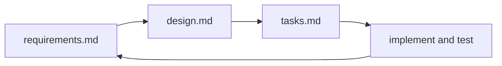

# Kiro workflow

Kiro is Stitchcraft's reference agent shell. The repository is arranged so a
Kiro agent can pick up one stage at a time with a small, precise context: the
rules live in steering, the intent lives in specs, the seams live in hooks and
contracts, and the work is staged as one `PROMPT.md` per stage.

Stitchcraft does not require Kiro. The CLI is model-free and agent-agnostic; the
`.kiro/` layer is process, not product. Kiro is simply where the whole loop —
steering, specs, hooks and agent tasks — is wired together.

## What Kiro loads

| Layer | Path | Role |
| --- | --- | --- |
| Steering | `.kiro/steering/*.md` | Persistent rules loaded into every agent task: product, tech and structure. |
| Specs | `.kiro/specs/stitchcraft-core/` | Requirements, design and tasks for the core. |
| Hooks | `.kiro/hooks/*.kiro.hook` | Edit-time and human-triggered checks that hold the seams. |
| Pipeline | `pipeline/pipeline.toml` | Stage order, dependencies and the QA gate. |
| Contracts | `contracts/*.schema.json` | The interface for every artifact. |
| Skills | `modules/<NN>-<slug>/SKILL.md` | The procedure for one job. |

Steering is intentionally short and normative. Kiro loads it on every task, so
it states rules ("one module, one job", "never weaken a contract") and points at
the deeper documents instead of duplicating them. The read order is in
`AGENTS.md`: README, steering, specs, pipeline, contracts.

## The spec-driven loop

Work in this repo follows the same loop Kiro uses for any feature:



1. **Requirements.** `requirements.md` holds numbered EARS requirements R1–R14
   ("WHEN … THE SYSTEM SHALL …"), each testable and each with a rationale.
2. **Design.** `design.md` shows how the architecture satisfies them: data flow,
   validation rules, dry-run prompt shape, error taxonomy, requirements
   traceability and trade-offs.
3. **Tasks.** `tasks.md` tracks milestones (M1 scaffold, M2 runner, M3 adapters)
   with checkboxes that cite the requirement ids they deliver.
4. **Implement.** Change requirements first when behaviour changes, then design,
   then tasks, then code and tests. Every requirement must appear in the design
   and in at least one task.

The `spec-sync` hook enforces the loop: editing any file under `.kiro/specs/`
asks the agent to keep the three documents mutually consistent and never tick a
task whose file or test does not exist. A green validator does not make a task
done; the Definition of Done in `AGENTS.md` does.

## Hooks in action

| Hook | Fires when | What the agent is asked to do |
| --- | --- | --- |
| `seam-check` | a contract, `module.toml` or `pipeline.toml` is edited | Run `validate --strict` and `plan`; fix modules, contracts and pipeline coherently; never weaken a contract to silence the validator. |
| `module-anatomy` | a module's `SKILL.md` or `module.toml` is edited | Check frontmatter, the seven required sections, real contract names, and that the hand-off names the exact artifact path. |
| `pipeline-gate` | a human triggers it | Run `python -m stitchcraft validate --strict` as a release-gate check. |
| `spec-sync` | a file under `.kiro/specs/**/*.md` is edited | Keep requirements, design and tasks consistent and traceable. |

Hooks are JSON files with `version`, `enabled`, `name`, `when` (trigger) and
`then` (action). `stitch validate` checks that every hook parses, has its
required keys, and uses a known trigger and action type — so a broken hook is a
pipeline error, not a silent no-op. When a hook asks for validation, run it,
fix the real defect and re-run; do not edit the hook or the contract to make the
message go away.

The hooks are an edit-time reminder. `stitch validate --strict` in CI is the
authority, and any agent — with or without Kiro — should run it after a seam
change.

## Walkthrough: a small site, nine stages

The seed request is `examples/coffee-roastery/request.md`. Typical session:

```bash
python -m pip install -e .
stitch validate --strict    # the repo is healthy before the run
stitch plan                 # orient: graph, table, gate at stage 8
stitch run --dry-run        # write nine PROMPT.md files under .stitch/
```

Then work stage by stage. Each prompt names the skill, the contracts and the
exact upstream artifact paths; open it in Kiro and execute the skill.

| Stage | Artifact to produce | Note |
| --- | --- | --- |
| 01 `brief` | `.stitch/01-brief/brief.json` | Seal the request; move unknowns to `open_questions`. |
| 02 `plan` | `.stitch/02-plan/site-plan.json` | Pages, navigation, content inventory. |
| 03 `design` | `.stitch/03-design/design-tokens.json` | Can run in parallel with 04. |
| 04 `copy` | `.stitch/04-copy/page-content.json` | Can run in parallel with 03. |
| 05 `build` | `.stitch/05-build/build-manifest.json` | Consumes both branches. |
| 06 `seo` | `.stitch/06-seo/seo-report.json` | Can run in parallel with 07. |
| 07 `a11y` | `.stitch/07-a11y/a11y-audit.json` | Can run in parallel with 06. |
| 08 `qa` | `.stitch/08-qa/qa-report.json` | Gate: a human reviews the verdict. |
| 09 `deploy` | `.stitch/09-deploy/deploy-plan.json` | Plan only; the human supplies credentials. |

After each stage run `stitch validate --strict` and fix seam errors before
moving on. After stage 08 the human reads the QA verdict: `pass` unlocks deploy,
`conditional` needs an explicit decision, and `fail` stops the run and sends the
blockers back to their owning modules. Stage 09 writes a deploy plan with
provider, environment, steps and rollback; it never deploys by itself.

## Commands

```bash
stitch list                                # stages, modules, artifacts, gates
stitch show brief                          # one module's seam and skill path
stitch plan                                # Mermaid graph + table
stitch run --dry-run                       # one PROMPT.md per stage
stitch run --dry-run --stage design        # refresh one stage prompt
stitch validate                            # findings, exit 1 if any error
stitch validate --strict --json            # warnings fail; machine-readable
stitch doctor                              # toolchain and repo-health checks
python -m unittest discover -s tests -v    # test suite
```

From the source tree without installing, use
`PYTHONPATH=src python -m stitchcraft <command>`. See [roadmap.md](roadmap.md) for
what `stitch run` will do beyond dry runs.

## Keeping context tight

- **One stage per task.** Open the stage's `PROMPT.md`, do that job, validate,
  stop. Parallel-safe stages (03/04, 06/07) can be separate Kiro tasks.
- **Read only what the prompt names:** the skill, the contracts for consumed and
  produced artifacts, and the upstream artifacts. Do not paste the repo or the
  whole plan into the conversation.
- **Use the CLI to orient**, not file dumps: `stitch plan` for the graph,
  `stitch show <module>` for one seam, `stitch list` for the whole pipeline.
- **Treat artifacts as memory.** Hand-offs are files; a fresh conversation can
  start from the artifact and the skill without re-reading old chat.
- **Record gaps, don't expand scope.** If the input is insufficient, write an
  `open_questions` entry or report the defect upstream; do not invent facts or
  do another module's job.
- **Keep steering short.** Steering loads on every task; durable detail belongs
  in docs, specs and skills.
- **Keep `.stitch/` out of git.** It is generated; only source changes are
  committed.

## What Kiro still needs from a human

- **The QA gate decision.** The gate is declared in the pipeline, but approving
  a release, accepting a `conditional` verdict or waiving a blocker is a human
  call. Review `.stitch/08-qa/qa-report.json` before deploy.
- **Deploy credentials and DNS.** Provider accounts, tokens, domains and TLS are
  supplied by the human. The deploy plan records environment keys and their
  source (`manual`, `repo-secret`, `provider-secret`); secrets never go into
  artifacts.
- **Brand and content facts.** Logos, photos, legal copy, prices and claims come
  from the client. `open_questions` exists so the agent does not invent them.
- **Taste and scope.** A quality bar can be mechanically checked; "does this
  feel right for the brand" cannot. Final copy and design review are human.
- **Contract amendments.** If a downstream module genuinely needs data no
  upstream artifact carries, a human decides the contract change and the
  producer is updated in the same change.
